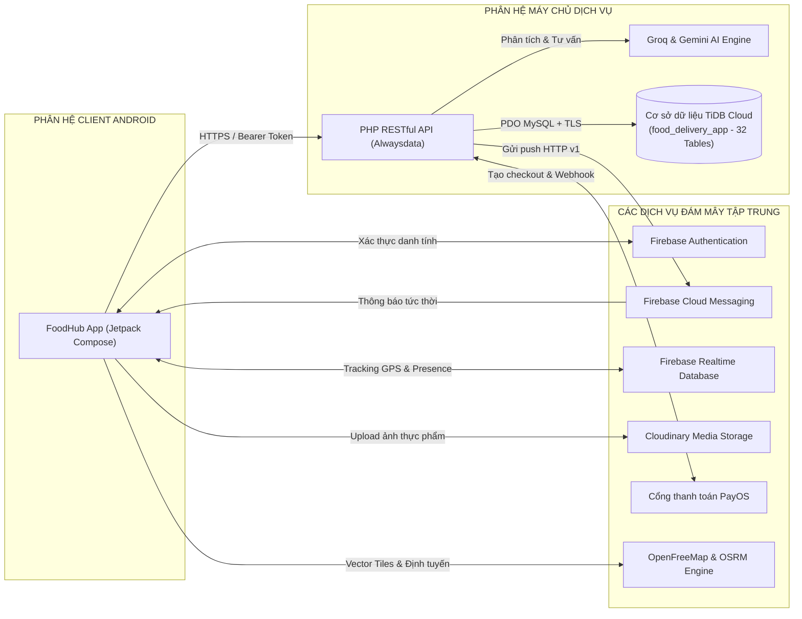

# CHƯƠNG 1. TỔNG QUAN VỀ DỰ ÁN

## 1.1. Chức năng

### 1.1.1. Yêu cầu chức năng

Hệ thống FoodHub được thiết kế thành một nền tảng thương mại điện tử đa tác nhân, kết nối đồng thời và đồng bộ 4 vai trò chính: Khách hàng (Customer), Nhà hàng (Restaurant / Seller), Tài xế giao hàng (Shipper / Driver) và Quản trị viên (Admin). Toàn bộ 4 vai trò này đều được vận hành thống nhất thông qua ứng dụng di động Android Native, tự động định tuyến giao diện dựa trên vai trò tài khoản được xác thực từ cơ sở dữ liệu máy chủ.

#### A. Yêu cầu chức năng dành cho Khách hàng (Customer)
Đây là phân hệ hướng đến người tiêu dùng cuối cùng, cung cấp trải nghiệm mua sắm thực phẩm trực quan, tiện lợi và an toàn:
1. **Đăng ký, Đăng nhập và Quản lý tài khoản:** Khách hàng có thể tạo tài khoản mới bằng Email/Mật khẩu hoặc sử dụng tính năng Đăng nhập nhanh bằng Google qua Android Credential Manager; quản lý thông tin cá nhân (họ tên, số điện thoại, ảnh đại diện tải lên Cloudinary).
2. **Quản lý Sổ địa chỉ giao nhận (Multi-Address Management):** Cho phép lưu nhiều địa chỉ nhận hàng; tích hợp công cụ tìm kiếm địa chỉ Photon và bản đồ kéo ghim tọa độ số nhà chính xác; thiết lập địa chỉ mặc định.
3. **Khám phá ẩm thực và Tìm kiếm món ăn:** Duyệt danh sách quán ăn đang mở cửa, xem banner các chương trình khuyến mãi dạng thẻ vuốt ngang, tìm kiếm món ăn theo từ khóa, lọc theo danh mục món ăn (Cơm, Bún/Phở, Trà sữa, Đồ ăn vặt).
4. **Xem chi tiết món ăn và Quán ăn:** Xem hình ảnh món chụp thực tế chất lượng cao, bảng giá chi tiết, mô tả thành phần, thông tin liên hệ và giờ mở/đóng cửa của quán.
5. **Quản lý Giỏ hàng thông minh (Smart Cart):** Thêm món vào giỏ hàng, tùy chỉnh số lượng món, áp dụng quy tắc kiểm tra chỉ đặt món của cùng một quán ăn trong một đơn hàng.
6. **Đặt hàng và Áp dụng mã Voucher (Order & Voucher Application):** Xác nhận thông tin nhận hàng, chọn voucher giảm giá khả dụng (giảm theo %, giảm tiền mặt hoặc miễn phí vận chuyển); hệ thống tự động kiểm tra điều kiện đơn hàng tối thiểu và chốt giá trên máy chủ.
7. **Thanh toán trực tuyến bảo mật qua cổng PayOS:** Hỗ trợ hai phương thức thanh toán linh hoạt: Trả tiền mặt khi nhận hàng (COD) hoặc quét mã VietQR tự động thông qua tích hợp cổng thanh toán trực tuyến PayOS.
8. **Theo dõi đơn hàng theo thời gian thực (Real-time Tracking):** Khách hàng theo dõi chi tiết từng trạng thái đơn hàng (Chờ xác nhận -> Quán chuẩn bị -> Chờ tài xế -> Đang giao -> Hoàn tất); bám sát vị trí di chuyển thực tế của tài xế trên bản đồ số MapLibre Native.
9. **Trợ lý ẩm thực thông minh AI ("Hôm nay ăn gì?"):** Tương tác trò chuyện tự nhiên với Trợ lý AI (Groq/Gemini) để nhận gợi ý món ăn phù hợp với ngân sách cá nhân, khẩu vị (món nước, món khô, ăn chay, không cay) và bấm trực tiếp vào thẻ món để mở quán đặt hàng.
10. **Nhắn tin trực tuyến (Real-time Chat):** Nhắn tin văn bản và gửi hình ảnh trao đổi trực tiếp với Quán ăn hoặc Tài xế giao hàng; nhận thông báo đẩy tức thời khi có tin nhắn mới.
11. **Hộp thư thông báo (Notification Center):** Nhận và lưu trữ các thông báo đẩy tự động về trạng thái đơn hàng, xác nhận thanh toán hoặc tin tức hệ thống.

#### B. Yêu cầu chức năng dành cho Nhà hàng / Quán ăn (Restaurant / Seller)
Phân hệ cung cấp các công cụ vận hành toàn diện giúp chủ quán quản lý kinh doanh hiệu quả:
1. **Thiết lập và Quản lý hồ sơ cửa hàng:** Đăng ký thương hiệu kinh doanh (`merchants`), tạo thông tin cửa hàng (`stores`), tải ảnh logo và ảnh bìa đại diện lên Cloudinary, cập nhật số điện thoại liên hệ, định vị tọa độ lấy hàng chính xác trên bản đồ.
2. **Cài đặt giờ hoạt động và Trạng thái đóng/mở cửa:** Thiết lập khung giờ mở cửa và đóng cửa (`open_time`, `close_time`), chủ động bật/tắt công tắc nhận đơn (`is_open`) để tạm dừng nhận đơn khi quá tải hoặc nghỉ lễ.
3. **Quản lý Thực đơn món ăn (Dish CRUD):** Tạo mới món ăn, chỉnh sửa thông tin, giá bán, mô tả, tải ảnh món ăn lên máy chủ, bật/tắt cờ còn hàng (`is_available`) hoặc xóa mềm món ăn khỏi thực đơn.
4. **Phân loại danh mục thực đơn (Menu Categories):** Tự do tạo và sắp xếp các nhóm món ăn trong thực đơn của quán (Khai vị, Món chính, Đồ uống, Món ăn kèm).
5. **Tiếp nhận và Điều phối đơn hàng:** Nhận thông báo đẩy tức thì (FCM) kèm âm thanh khi có đơn hàng mới; xem chi tiết các món khách đặt; chuyển trạng thái đơn hàng sang Đang chuẩn bị (`processing`) và Đã sẵn sàng giao (`accepted`) để hệ thống phân phối cho tài xế.
6. **Nhật ký hoạt động và Thống kê vận hành:** Xem nhật ký các thao tác thay đổi thực đơn hoặc cập nhật quán (`activity_logs`); theo dõi tổng số đơn hàng đã hoàn tất trong ngày.

#### C. Yêu cầu chức năng dành cho Tài xế giao hàng (Shipper / Driver)
Phân hệ hỗ trợ tài xế tối ưu hóa quy trình giao nhận đơn hàng trên đường phố:
1. **Quản lý Hồ sơ tài xế và Phương tiện:** Cập nhật thông tin phương tiện giao hàng (loại xe, dòng xe, biển số xe); theo dõi số chuyến đi đã hoàn thành và đánh giá sao.
2. **Chuyển đổi trạng thái làm việc:** Bật/tắt trạng thái Sẵn sàng nhận đơn (`available`) hoặc Ngoại tuyến (`offline`). Khi đang thực hiện cuốc giao, hệ thống tự động khóa trạng thái Đang bận (`busy`).
3. **Bảng tin tìm kiếm và Tiếp nhận đơn hàng (Available Orders Pool):** Xem danh sách các đơn hàng đã được quán chuẩn bị xong (`accepted`) chưa có người nhận trong khu vực; thao tác nhận đơn áp dụng cơ chế khóa bi quan CSDL (Pessimistic Lock) để chống tranh chấp đơn giữa các tài xế.
4. **Bản đồ điều hướng và Định tuyến lộ trình (MapLibre & OSRM):** Hiển thị bản đồ vector số trực quan; tự động vẽ tuyến đường di chuyển từ vị trí hiện tại của tài xế đến quán ăn lấy hàng, sau đó vẽ tuyến từ quán ăn đến địa chỉ của khách hàng dựa trên động cơ OSRM.
5. **Phát tọa độ trực tiếp (Live Location Streaming):** Tự động phát liên tục tọa độ GPS của thiết bị lên Firebase Realtime Database (`tracking/{orderId}`) trong suốt quá trình đi giao để khách hàng theo dõi.
6. **Xác nhận giao hàng thành công:** Chuyển trạng thái đơn sang Đang giao (`shipping`) khi đã lấy món tại quán và Hoàn tất (`completed`) khi đã bàn giao thức ăn cho khách hàng.
7. **Báo cáo và Thống kê thu nhập giao hàng (Shipper Earnings Summary):** Tổng hợp thu nhập từ phí giao hàng (`shippingFee`) của các đơn hàng đã hoàn tất; biểu đồ trực quan hóa doanh thu theo tuần và theo tháng dựa trên mốc thời gian hoàn thành thực tế (`completedAt`).

#### D. Yêu cầu chức năng dành cho Quản trị viên (Admin)
Phân hệ quản trị cấp cao nắm quyền điều hành và giám sát toàn bộ hoạt động của nền tảng:
1. **Bảng điều khiển Giám sát Doanh thu (Analytics Dashboard):** Tổng hợp số liệu tài chính toàn sàn theo ngày, tuần, tháng; biểu đồ doanh thu lũy kế; thống kê tổng số đơn đặt, tỷ lệ đơn hoàn thành, tỷ lệ đơn bị hủy.
2. **Quản lý Tài khoản người dùng (User Management):** Duyệt danh sách toàn bộ người dùng, tìm kiếm theo tên hoặc email; chỉnh sửa thông tin, phân quyền vai trò (Customer, Seller, Driver, Admin); khóa (`suspended`) hoặc mở khóa tài khoản vi phạm.
3. **Quản lý Chương trình khuyến mãi (Voucher Management):** Tạo mới mã voucher giảm giá toàn sàn hoặc áp dụng cho quán ăn cụ thể; thiết lập loại giảm (theo %, số tiền cố định, miễn phí ship), hạn mức giảm tối đa, giá trị đơn hàng tối thiểu và số lượt sử dụng tối đa.
4. **Giám sát Nhật ký hệ thống và Hỗ trợ khách hàng:** Theo dõi các cuộc hội thoại hỗ trợ khiếu nại (`conversations.type='support'`); tra cứu nhật ký hoạt động hệ thống để phát hiện các bất thường trong vận hành.

---

### 1.1.2. Yêu cầu Phi chức năng

Nhằm đảm bảo hệ thống vận hành ổn định, bảo mật và mang lại trải nghiệm tối ưu cho người dùng, các yêu cầu phi chức năng sau đây được thiết lập và tuân thủ chặt chẽ:

1. **Yêu cầu về Tính tiến hóa và Khả năng mở rộng (Maintainability & Scalability):**
   - Phân hệ Android được xây dựng theo kiến trúc MVVM kết hợp Jetpack Compose và Kotlin Coroutines, mã nguồn được module hóa rõ ràng theo từng Feature (`feature/customer`, `feature/restaurant`, `feature/shipper`, `feature/admin`).
   - Phân hệ Backend API được thiết kế theo chuẩn RESTful không trạng thái (Stateless), dễ dàng mở rộng theo chiều ngang (Horizontal Scaling) hoặc chuyển đổi sang kiến trúc Microservices khi lưu lượng người dùng tăng cao.
   - Cơ sở dữ liệu sử dụng TiDB Cloud Serverless với khả năng tự động co giãn tài nguyên (Auto-scaling) theo tải truy vấn thực tế.

2. **Yêu cầu về Hiệu năng và Tốc độ đáp ứng (Performance & Efficiency):**
   - Tốc độ phản hồi của các API truy vấn nghiệp vụ thông thường trên Alwaysdata đạt thời gian trung bình dưới 300ms sau khi kết nối PDO được làm nóng.
   - Thời gian khởi động ứng dụng nhanh, giao diện cuộn mượt mà với tốc độ 60 khung hình/giây (fps), loại bỏ hoàn toàn hiện tượng nghẽn giao diện (UI jank).
   - Tối ưu hóa tải ảnh thông qua Cloudinary và thư viện Coil với cơ chế tự động nén kích thước và bộ nhớ đệm hai tầng (Memory Cache & Disk Cache).
   - Module AI Meal Advisor tích hợp cơ chế bộ nhớ đệm kết quả 5 phút cho mỗi tài khoản, ngắt chờ Google sau 5.5 giây và tự động sử dụng bộ lọc dự phòng thông minh khi dịch vụ bên thứ ba quá tải.

3. **Yêu cầu về Tính tương thích (Compatibility):**
   - Ứng dụng di động hỗ trợ dải thiết bị Android rộng với `minSdk = 29` (Android 10) đến `compileSdk = 36` (Android 15), tương thích tốt với nhiều kích thước màn hình smartphone phổ biến hiện nay.
   - Sử dụng các thư viện mã nguồn mở tiêu chuẩn không phụ thuộc vào các dịch vụ tính phí độc quyền (sử dụng MapLibre Native thay cho Google Maps SDK, sử dụng Photon Geocoding thay cho Google Places API).

4. **Yêu cầu về Bảo mật và Toàn vẹn Dữ liệu (Security & Integrity):**
   - **Xác thực phi trạng thái (Stateless JWT):** Không lưu trữ mật khẩu người dùng trong cơ sở dữ liệu quan hệ. Mọi phiên đăng nhập đều được chứng thực bởi Firebase Authentication và bảo vệ bằng Firebase ID Token có chữ ký số RSA (RS256).
   - **Mã hóa đường truyền:** 100% các kết nối giữa Android Client, Máy chủ Backend và CSDL TiDB Cloud đều bắt buộc mã hóa qua giao thức HTTPS và TLS với chứng chỉ số xác thực tin cậy (`ISRG Root X1`).
   - **Bảo mật giao dịch thanh toán:** Các thông điệp Webhook từ cổng thanh toán PayOS được kiểm tra chữ ký băm mật mã HMAC-SHA256 với khóa bí mật (`checksum_key`), đảm bảo không thể bị giả mạo trạng thái thanh toán.
   - **Chống gian lận đơn hàng:** Máy chủ chịu trách nhiệm tính toán lại toàn bộ đơn giá món ăn từ cơ sở dữ liệu, áp dụng phí giao hàng và voucher; ứng dụng khách không có quyền tự quyết định tổng tiền đơn hàng.

5. **Yêu cầu về Trải nghiệm Người dùng (UI/UX Design):**
   - Tuân thủ ngôn ngữ thiết kế Material 3 hiện đại, sử dụng bảng màu chủ đạo Trắng và Xanh dương (`#2159BC`), màu nền dịu nhẹ (`#F5F8FC` / `#F8F9FA`).
   - Đồng bộ hóa 100% nhãn giao diện, nút bấm, thông báo trạng thái và biểu mẫu bằng ngôn ngữ Tiếng Việt thân thiện, rõ ràng, phù hợp với thói quen của người tiêu dùng trong nước.
   - Trải nghiệm bản đồ mượt mà, hỗ trợ thao tác chạm vuốt đa điểm, tự động tạm khóa cuộn trang khi tương tác với bản đồ để tránh xung đột cử chỉ.

6. **Yêu cầu về Pháp lý và Quyền riêng tư (Legal & Privacy):**
   - Tuân thủ các quy định hiện hành về bảo vệ dữ liệu cá nhân (PDPA / Nghị định 13/2023/NĐ-CP). Dữ liệu vị trí GPS của người dùng chỉ được thu thập khi người dùng chủ động cho phép và chỉ phục vụ duy nhất cho mục đích định tuyến giao nhận đơn hàng.

---

## 1.2. Yêu cầu đặt ra đối với hệ thống

### 1.2.1. Công cụ và môi trường phát triển

Để phục vụ quá trình nghiên cứu, xây dựng và kiểm thử hệ thống phân tán đa nền tảng FoodHub, các công cụ phần cứng và phần mềm sau đây đã được trang bị và thiết lập:

- **Thiết bị phần cứng phát triển:**
  - Máy tính cá nhân (PC/Laptop) cấu hình CPU đa nhân (Intel Core i7 / AMD Ryzen), bộ nhớ RAM tối thiểu 16GB, ổ cứng thể rắn SSD tốc độ cao để đảm bảo khả năng biên dịch Gradle và khởi chạy máy chủ ảo mượt mà.
  - Thiết bị di động thử nghiệm thực tế: Điện thoại thông minh Samsung Galaxy A23 (chạy Android 14) kết nối gỡ lỗi qua USB Debugging.
- **Môi trường phát triển ứng dụng di động (Mobile Client):**
  - Môi trường phát triển tích hợp Android Studio (phiên bản Ladybug / Meerkat) kết hợp bộ công cụ phát triển Android SDK (API Level 29 đến 36).
  - Trình biên dịch Gradle Wrapper 9.1.0 kết hợp Android Gradle Plugin (AGP) 9.0.1, hỗ trợ biên dịch mã nguồn Kotlin 2.0 và Jetpack Compose.
- **Môi trường phát triển hệ thống máy chủ (Backend Server):**
  - Môi trường phát triển mã nguồn: Visual Studio Code và JetBrains PhpStorm.
  - Máy chủ thử nghiệm cục bộ (Local Environment): PHP 8.2 CLI tích hợp sẵn các phần mở rộng bắt buộc: `pdo_mysql`, `openssl`, `curl`, `mbstring`, `json`.
  - Máy chủ triển khai sản xuất (Production Hosting): Máy chủ đám mây Alwaysdata (Apache, PHP 8.4.27) với đầy đủ hỗ trợ kết nối bảo mật HTTPS và chứng chỉ SSL/TLS.
- **Hệ thống Quản trị Cơ sở Dữ liệu (Database Management):**
  - Cụm cơ sở dữ liệu phân tán TiDB Cloud Serverless (tương thích giao thức MySQL 8.0) lưu trữ 32 bảng nghiệp vụ.
  - Công cụ quản trị trực quan: DBeaver Community Edition và MySQL Workbench hỗ trợ thiết kế sơ đồ thực thể và thực thi các câu truy vấn DDL/DML có mã hóa SSL.
- **Công cụ kiểm thử và kết nối mạng:**
  - Phần mềm Postman và cURL để kiểm thử độc lập các điểm cuối RESTful API trước khi tích hợp vào ứng dụng di động.
  - Tiện ích Ngrok tạo đường hầm bảo mật (Secure Tunnel) hỗ trợ kiểm thử Webhook cục bộ từ cổng thanh toán PayOS.

---

### 1.2.2. Yêu cầu kiến trúc hệ thống

Hệ thống FoodHub được xây dựng dựa trên mô hình Client - Server phân tán, phân định ranh giới trách nhiệm rõ ràng giữa tầng Ứng dụng khách (Frontend Client) và tầng Dịch vụ máy chủ (Backend Services):

- **Nguyên tắc phân định kiến trúc:**
  - **Phân hệ Client (Android Native):** Đóng vai trò hiển thị giao diện, thu nhận thao tác của người dùng, quản lý trạng thái giao diện cục bộ (Local UI State), thu nhận tọa độ GPS và gửi yêu cầu dữ liệu lên máy chủ. Client không trực tiếp ghi dữ liệu vào CSDL quan hệ.
  - **Phân hệ Máy chủ (Backend API):** Đóng vai trò là trung tâm kiểm soát toàn bộ nghiệp vụ (Single Source of Business Rules), chịu trách nhiệm kiểm tra tính hợp lệ của token xác thực, phân quyền vai trò, kiểm tra tính toàn vẹn của giỏ hàng, chốt giá đơn hàng, mở khóa giao dịch chống tranh chấp và ghi nhận lịch sử vào cơ sở dữ liệu.
  - **Cơ sở dữ liệu tập trung (TiDB Cloud):** Lưu trữ toàn bộ 32 bảng dữ liệu nghiệp vụ có cấu trúc, đảm bảo tính nhất quán dữ liệu ACID và khả năng chịu tải cao.

---

## 1.3. Ngăn xếp công nghệ sử dụng

### 1.3.1. Ngôn ngữ lập trình Kotlin
Kotlin là ngôn ngữ lập trình hiện đại do JetBrains phát triển, được Google công nhận là ngôn ngữ phát triển ưu tiên số một (Kotlin-first) cho nền tảng Android. Trong dự án FoodHub, Kotlin đóng vai trò là nền tảng cốt lõi xây dựng toàn bộ ứng dụng di động:
- **Null Safety (An toàn kiểu dữ liệu):** Cơ chế loại bỏ hoàn toàn ngoại lệ trỏ rỗng (`NullPointerException`), đảm bảo ứng dụng không bị đột tử trong các tác vụ phân tích JSON phức tạp.
- **Coroutines & Asynchronous Programming:** Xử lý bất đồng bộ mạnh mẽ và nhẹ hơn luồng hệ thống thông thường, giúp việc gọi API mạng, đọc bộ nhớ đệm và tải dữ liệu diễn ra mượt mà trong nền mà không làm giật khung hình giao diện người dùng.
- **Data Classes & Extension Functions:** Cung cấp cú pháp ngắn gọn, trong sáng để định nghĩa các mô hình dữ liệu (Models) và mở rộng tính năng cho các lớp có sẵn mà không cần kế thừa phức tạp.

---

### 1.3.2. Jetpack Compose & Material 3
Jetpack Compose là bộ công cụ xây dựng giao diện người dùng khai báo (Declarative UI Toolkit) thế hệ mới của Google, thay thế hoàn toàn mô hình XML Layout truyền thống:
- **Mô hình lập trình khai báo:** Giao diện được mô tả dưới dạng các hàm `@Composable` phản ứng trực tiếp với sự thay đổi của trạng thái (State). Khi dữ liệu trong `StateFlow` thay đổi, hệ thống chỉ vẽ lại (Recompose) các thành phần giao diện bị ảnh hưởng, tối ưu hóa tối đa hiệu năng dựng hình.
- **Hệ thống thiết kế Material 3:** Triển khai các thành phần giao diện chuẩn mực (Buttons, Cards, NavigationBar, TopAppBar, BottomSheet) với khả năng tùy biến màu sắc linh hoạt, tạo nên phong cách trẻ trung, hiện đại và chuẩn công nghiệp.

---

### 1.3.3. Framework Backend PHP & PDO MySQL
Phân hệ máy chủ dịch vụ của FoodHub được phát triển bằng ngôn ngữ PHP (phiên bản 8.2 trên môi trường thử nghiệm và 8.4 trên máy chủ Alwaysdata) kết hợp cùng lớp trừu tượng dữ liệu PDO (PHP Data Objects):
- **Cơ chế Front-Controller Router gọn nhẹ:** Tệp `backend/api/index.php` đóng vai trò là bộ định tuyến tập trung, xử lý ánh xạ tài nguyên RESTful, kiểm tra các phương thức HTTP (GET, POST, PUT, PATCH, DELETE) và chuẩn hóa dữ liệu đầu ra theo định dạng JSON UTF-8.
- **Prepared Statements & Phòng chống SQL Injection:** Toàn bộ các thao tác truy vấn CSDL đều sử dụng câu lệnh chuẩn bị sẵn với tham số ràng buộc (`$pdo->prepare()`), loại bỏ triệt để nguy cơ tấn công tiêm mã SQL Injection.
- **Quản lý Giao dịch và Khóa dữ liệu (Transaction & Row-level Locking):** Sử dụng các lệnh `beginTransaction()`, `commit()`, `rollBack()` kết hợp `FOR UPDATE` để đảm bảo tính nhất quán tuyệt đối trong các thao tác thanh toán, trừ tồn kho và tranh chấp nhận đơn của tài xế.

---

### 1.3.4. Hệ quản trị CSDL TiDB Cloud Serverless (MySQL Compatible)
TiDB Cloud là một hệ quản trị cơ sở dữ liệu quan hệ phân tán (Distributed NewSQL Database) thế hệ mới, có khả năng tương thích 100% với giao thức và cú pháp của MySQL 8.0:
- **Kiến trúc Serverless & Auto-scaling:** Tự động mở rộng năng lực tính toán và dung lượng lưu trữ theo tải thực tế của ứng dụng mà không cần dừng hệ thống.
- **Bảo mật đường truyền với TLS/SSL:** Bắt buộc mã hóa toàn bộ dữ liệu lưu chuyển giữa ứng dụng PHP và cụm máy chủ TiDB thông qua chứng chỉ CA `ISRG Root X1`.
- **Hỗ trợ đầy đủ 32 bảng nghiệp vụ:** Triển khai cấu trúc bảng chuẩn với các ràng buộc khóa ngoại (Foreign Keys), chỉ mục tìm kiếm (Indexes), các trường dữ liệu tự tăng (`AUTO_INCREMENT`) và múi giờ phiên làm việc chuẩn hóa `+07:00` (Asia/Ho_Chi_Minh).

---

### 1.3.5. Nền tảng Google Firebase (Auth, FCM, Realtime Database)
Dự án tận dụng sức mạnh của hệ sinh thái Google Firebase cho các tác vụ đặc thù:
- **Firebase Authentication:** Quản lý tài khoản và phiên đăng nhập an toàn của người dùng (hỗ trợ Email/Mật khẩu và Google ID Token qua Android Credential Manager). Sau khi đăng nhập thành công, Firebase cấp một chuỗi mã thông báo Firebase ID Token (JWT RS256) chứa định danh duy nhất `sub` (Firebase UID). Mã thông báo này được gửi kèm trong Header `Authorization: Bearer <token>` để máy chủ PHP xác thực danh tính.
- **Firebase Cloud Messaging (FCM HTTP v1):** Máy chủ backend sử dụng Service Account JSON để tự động ký JWT, lấy Google OAuth2 token và gửi các thông báo đẩy trực tiếp đến thiết bị người dùng (thông báo đơn hàng mới cho chủ quán, thông báo cập nhật tiến độ cho khách).
- **Firebase Realtime Database (RTDB):** Đóng vai trò là kênh lưu trữ dữ liệu thời gian thực tốc độ cao cho các thông tin tạm thời: Tọa độ GPS di chuyển của shipper (`tracking/{orderId}`), trạng thái Online/Offline của người dùng (`presence/{uid}`) và trạng thái đang gõ phím (`typing`).

---

### 1.3.6. Dịch vụ Quản lý Đa phương tiện Cloudinary
Cloudinary là nền tảng quản lý hình ảnh và video trên nền điện toán đám mây:
- **Tải ảnh phân tán:** Phân hệ Android sử dụng Cloudinary Android SDK để tải ảnh đại diện người dùng, logo quán ăn và hình chụp thực tế của món ăn trực tiếp lên đám mây Cloudinary.
- **Tối ưu hóa băng thông:** Cloudinary tự động nén kích thước, chuyển đổi định dạng ảnh tối ưu (WebP) và phân phối qua mạng lưới CDN toàn cầu, giúp ứng dụng di động tải ảnh nhanh chóng mà không gây quá tải cho máy chủ backend.

---

### 1.3.7. Thư viện Bản đồ số MapLibre Native & OpenFreeMap
Nhằm đảm bảo tính độc lập về mặt công nghệ và không phụ thuộc vào các dịch vụ bản đồ thương mại đắt đỏ (như Google Maps Platform):
- **MapLibre Native Android SDK (13.7.1):** Thư viện dựng bản đồ vector mã nguồn mở với hiệu năng cao, tận dụng phần cứng GPU để vẽ các lớp bản đồ mượt mà ở tốc độ 60fps.
- **OpenFreeMap Tile Server:** Cung cấp nguồn dữ liệu gạch bản đồ (Vector Tiles) miễn phí với phong cách Liberty hiện đại, chi tiết và sắc nét cho toàn lãnh thổ Việt Nam.
- **Photon Geocoding & Android Geocoder:** Hỗ trợ tìm kiếm địa chỉ dạng chuỗi văn bản với độ trễ thấp và chuyển đổi tọa độ GPS thành địa chỉ số nhà thực tế.
- **OSRM (Open Source Routing Machine):** Động cơ định tuyến đường đi mã nguồn mở, hỗ trợ tính toán lộ trình di chuyển tối ưu và hiển thị đường kẻ dẫn hướng (Polyline) cho tài xế giao hàng.

---

### 1.3.8. Cổng thanh toán trực tuyến PayOS
Cổng thanh toán PayOS được tích hợp nhằm hiện thực hóa giải pháp thanh toán không dùng tiền mặt hiện đại:
- **Thanh toán tự động qua mã VietQR:** Khi khách hàng chọn thanh toán PayOS, máy chủ tạo phiên giao dịch qua API PayOS và sinh mã QR chuyển khoản ngân hàng gắn liền với số tiền đơn hàng và mã thanh toán duy nhất.
- **Xác thực Webhook an toàn với HMAC-SHA256:** Khi khách hàng hoàn tất chuyển khoản thành công trên ứng dụng ngân hàng, PayOS gửi thông báo Webhook về máy chủ `POST /payos/webhook`. Máy chủ thực hiện kiểm tra chữ ký băm mật mã HMAC-SHA256 để đối soát dòng tiền và tự động cập nhật trạng thái đơn hàng sang Đã thanh toán (`paid`).

---

### 1.3.9. Trợ lý Ẩm thực Thông minh AI (Groq & Gemini LLM)
FoodHub tiên phong tích hợp trí tuệ nhân tạo thế hệ mới (Generative AI) vào trải nghiệm người dùng:
- **Mô hình Ngôn ngữ Lớn (LLM):** Ứng dụng mô hình mã nguồn mở tốc độ cao `openai/gpt-oss-120b` trên nền tảng Groq và mô hình Gemini 4 Hydrogen của Google.
- **Tư vấn thực đơn có kiểm soát (Guardrails & Context-grounded Recommendation):** Người dùng nhập câu hỏi tự nhiên kèm ngân sách mong muốn (ví dụ: *"Tìm cho tôi món nước dưới 50k"*). Máy chủ PHP thực hiện trích xuất danh sách món ăn thực tế đang bán từ TiDB Cloud, kết hợp cùng các ràng buộc an toàn thực phẩm, phân tích ngữ cảnh hội thoại đa lượt và yêu cầu mô hình AI chọn ra tối đa 3 món ăn phù hợp nhất. Người dùng có thể nhấn trực tiếp vào thẻ món đề xuất để mở cửa hàng và tiến hành đặt món.
