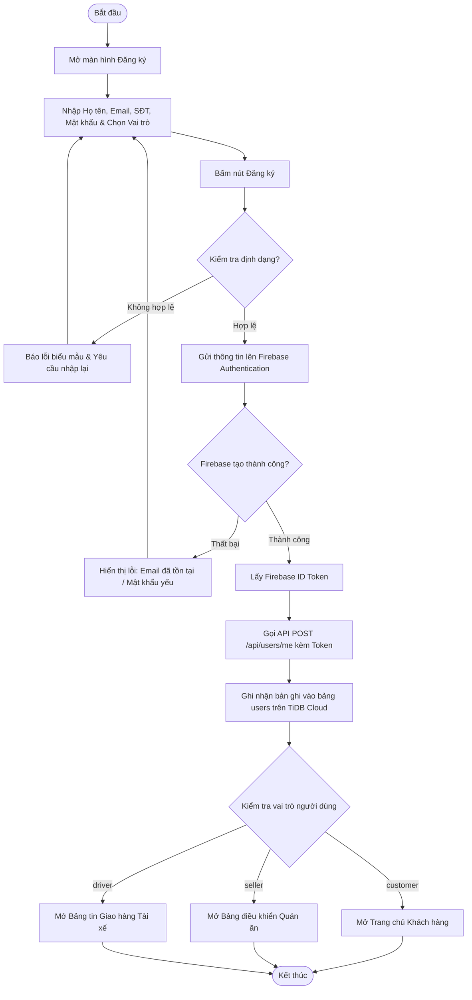
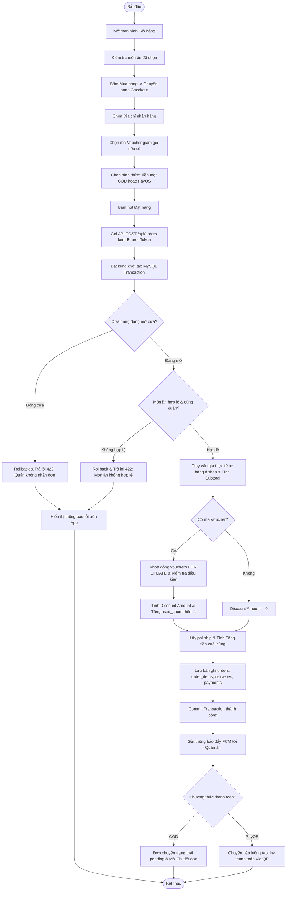
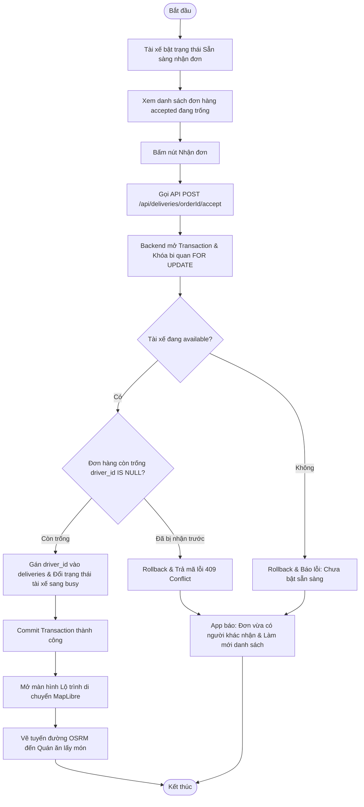
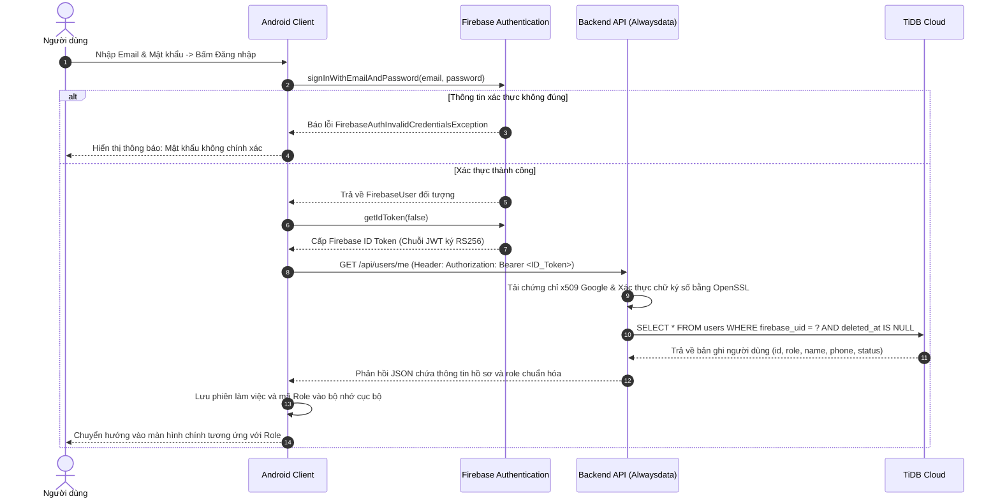
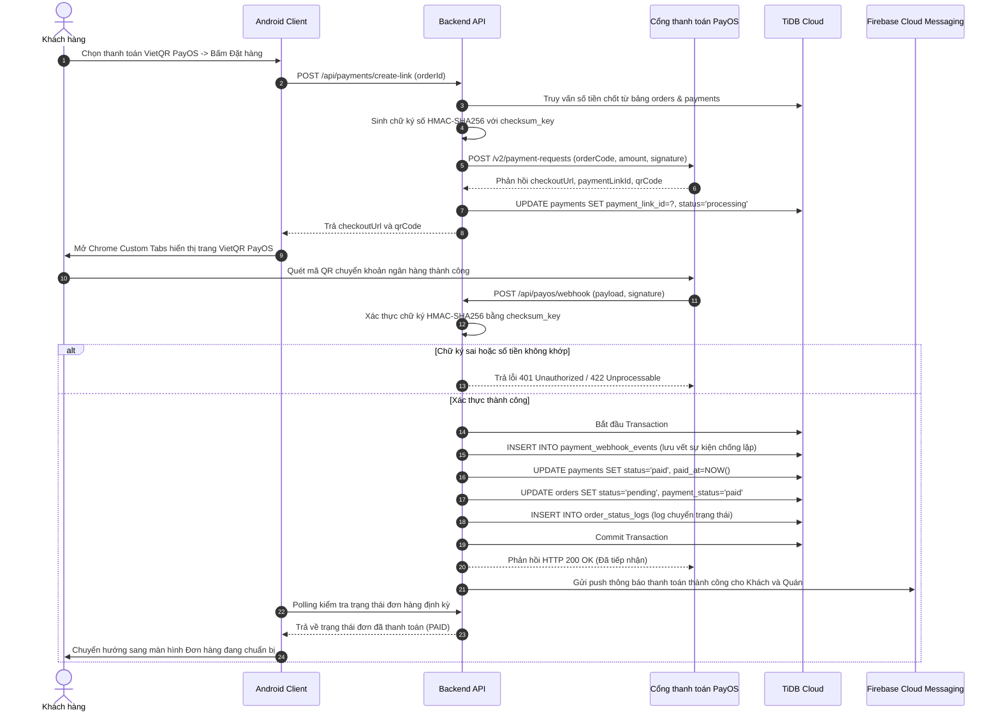
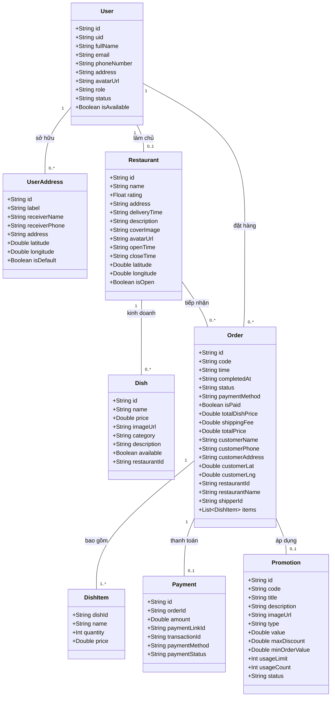
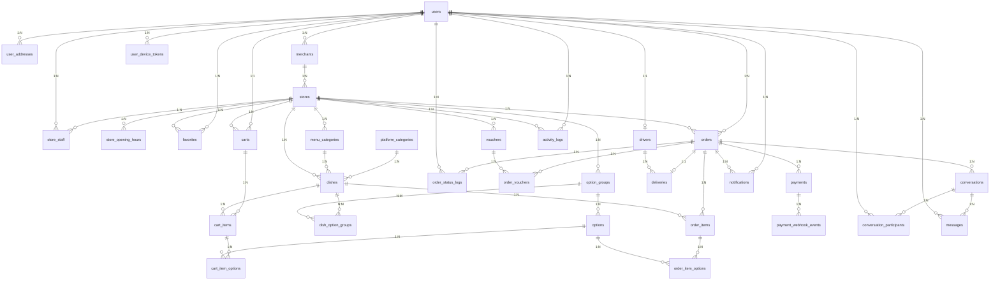

# CHƯƠNG 2. PHÂN TÍCH THIẾT KẾ HỆ THỐNG VÀ DATABASE

## 2.1. Phân tích thiết kế hệ thống

### 2.1.1. Các tác nhân của hệ thống

Hệ thống FoodHub được xây dựng để phục vụ mô hình kinh doanh giao đồ ăn trực tuyến bốn bên (4-sided Marketplace). Mỗi tác nhân đóng một vai trò chuyên biệt và có phạm vi trách nhiệm nghiệp vụ rõ ràng:

| STT | Tác nhân (Actor) | Biểu tượng | Ý nghĩa, vai trò và nhiệm vụ trong hệ thống |
| :---: | :--- | :---: | :--- |
| 1 | **Khách hàng** *(Customer / User)* | 👤 | Là người tiêu dùng sử dụng ứng dụng di động để tìm kiếm quán ăn, duyệt món, nhận gợi ý từ AI, đặt hàng, lựa chọn địa chỉ giao nhận, thực hiện thanh toán trực tuyến qua PayOS hoặc tiền mặt, bám sát hành trình giao hàng của tài xế trên bản đồ số và trao đổi tin nhắn trực tiếp với quán hoặc tài xế. |
| 2 | **Nhà hàng / Quán ăn** *(Restaurant / Seller)* | 🏪 | Là các đối tác kinh doanh dịch vụ ăn uống. Quán ăn sử dụng ứng dụng để quản lý thông tin cửa hàng, định vị vị trí lấy hàng, thiết lập khung giờ hoạt động, quản trị thực đơn món ăn (thêm, sửa, xóa món, cập nhật giá và tồn kho), tiếp nhận đơn hàng tức thời qua thông báo đẩy và cập nhật tiến độ chế biến món ăn. |
| 3 | **Tài xế giao hàng** *(Shipper / Driver)* | 🛵 | Là đối tác vận chuyển thực hiện việc nhận đơn hàng từ quán ăn và giao đến tay khách hàng. Tài xế sử dụng ứng dụng để quản lý trạng thái làm việc (sẵn sàng/bận/offline), nhận đơn hàng trong khu vực qua cơ chế khóa chống tranh chấp, xem chỉ đường định tuyến trên bản đồ MapLibre, phát tọa độ GPS thời gian thực và theo dõi báo cáo thu nhập cá nhân. |
| 4 | **Quản trị viên** *(Admin)* | 🛡️ | Là người có quyền hạn cao nhất trong hệ thống, chịu trách nhiệm quản trị tổng thể hoạt động của nền tảng: Giám sát bảng điều khiển doanh thu, theo dõi số lượng đơn hàng biến động, quản lý tài khoản và phân quyền người dùng, thiết lập các chương trình khuyến mãi (Voucher) toàn sàn và xử lý các vấn đề khiếu nại phát sinh. |

*Bảng 2-1: Danh sách và đặc tả các tác nhân trong hệ thống FoodHub*

---

### 2.1.2. Các use case của tác nhân

Dựa trên việc khảo sát quy trình nghiệp vụ và mã nguồn thực tế, hệ thống xác định danh mục các Use Case theo từng tác nhân như sau:

#### A. Phân hệ Khách hàng (Customer)
| Tên Use Case | Mô tả chi tiết chức năng |
| :--- | :--- |
| **Đăng ký tài khoản** | Khách hàng đăng ký tài khoản mới bằng Email/Mật khẩu hoặc thông qua Google Sign-In; hệ thống tự động đồng bộ hồ sơ sang CSDL TiDB với vai trò mặc định là `customer`. |
| **Đăng nhập & Xác thực** | Xác thực danh tính qua Firebase Auth, nhận mã xác thực Firebase ID Token (JWT RS256) để truy cập các dịch vụ mạng của hệ thống. |
| **Đăng xuất** | Hủy phiên làm việc trên thiết bị, xóa token lưu trữ cục bộ và ngắt trạng thái hiện diện (Presence). |
| **Quản lý thông tin cá nhân** | Cập nhật họ tên, số điện thoại, tải ảnh đại diện lên Cloudinary; quản lý sổ địa chỉ giao nhận (hỗ trợ kéo ghim GPS và tìm kiếm số nhà Photon). |
| **Tìm kiếm & Lọc món ăn** | Tìm kiếm món ăn theo từ khóa, duyệt danh sách quán ăn đang hoạt động và lọc món ăn theo danh mục ẩm thực. |
| **Xem chi tiết món & Quán** | Xem hình ảnh chất lượng cao, đơn giá, thành phần món ăn, thông tin giờ mở cửa và địa chỉ của quán. |
| **Quản lý giỏ hàng** | Thêm món ăn vào giỏ, tùy chỉnh số lượng món, áp dụng quy tắc kiểm tra giỏ hàng chỉ thuộc một quán ăn duy nhất. |
| **Đặt hàng** | Nhập địa chỉ nhận hàng, chọn voucher giảm giá khả dụng, chọn phương thức thanh toán; máy chủ tự động kiểm tra tồn kho, tính lại đơn giá và chốt tổng tiền. |
| **Thanh toán trực tuyến PayOS** | Kết nối cổng PayOS, sinh mã VietQR tự động để khách hàng thanh toán qua ứng dụng ngân hàng và nhận thông báo xác nhận tự động qua Webhook. |
| **Theo dõi đơn hàng thời gian thực**| Theo dõi chi tiết các mốc trạng thái của đơn hàng; xem vị trí di chuyển trực tiếp của tài xế trên bản đồ MapLibre. |
| **Trợ lý ẩm thực AI** | Tương tác tự nhiên với AI ("Hôm nay ăn gì?") để nhận gợi ý món ăn phù hợp với ngân sách và khẩu vị, bấm vào thẻ món để mở quán đặt hàng. |
| **Nhắn tin trực tuyến (Chat)** | Gửi tin nhắn văn bản và hình ảnh trao đổi trực tiếp với Quán ăn hoặc Tài xế giao hàng; xem trạng thái đã gửi/đã đọc. |

*Bảng 2-2: Danh mục Use Case phân hệ Khách hàng*

#### B. Phân hệ Nhà hàng / Quán ăn (Restaurant / Seller)
| Tên Use Case | Mô tả chi tiết chức năng |
| :--- | :--- |
| **Quản lý hồ sơ quán ăn** | Thiết lập tên quán, mô tả, số hotline, định vị tọa độ lấy món trên bản đồ số, tải ảnh bìa và logo quán lên Cloudinary. |
| **Cài đặt giờ hoạt động** | Cấu hình giờ mở cửa, giờ đóng cửa và chủ động bật/tắt công tắc nhận đơn (`is_open`) của quán. |
| **Quản lý thực đơn món ăn** | Thực hiện các thao tác Thêm mới, Chỉnh sửa, Đổi giá bán, Cập nhật ảnh Cloudinary, Bật/Tắt còn hàng và Xóa mềm món ăn khỏi thực đơn. |
| **Quản lý danh mục quán** | Tạo mới và phân loại các nhóm món ăn trong thực đơn của quán (menu categories). |
| **Tiếp nhận & Chế biến đơn** | Nhận thông báo đẩy FCM kèm âm thanh khi có đơn mới; duyệt đơn, chuyển trạng thái đơn sang Đang chuẩn bị (`processing`) và Đã sẵn sàng (`accepted`). |
| **Xem nhật ký hoạt động** | Theo dõi lịch sử các thao tác thay đổi thực đơn hoặc cập nhật quán ăn (`activity_logs`). |

*Bảng 2-3: Danh mục Use Case phân hệ Nhà hàng*

#### C. Phân hệ Tài xế giao hàng (Shipper / Driver)
| Tên Use Case | Mô tả chi tiết chức năng |
| :--- | :--- |
| **Quản lý hồ sơ & Phương tiện**| Cập nhật thông tin phương tiện giao hàng (loại xe, dòng xe, biển số xe); theo dõi số chuyến đi đã hoàn thành và đánh giá sao. |
| **Bật/Tắt trạng thái làm việc**| Chuyển đổi trạng thái làm việc giữa Ngoại tuyến (`offline`) và Sẵn sàng nhận đơn (`available`). |
| **Tiếp nhận đơn hàng giao** | Xem danh sách các đơn hàng đã được quán nấu xong (`accepted`) chưa có người nhận; bấm nhận đơn với cơ chế khóa CSDL chống tranh chấp. |
| **Định tuyến & Bám lộ trình** | Xem bản đồ dẫn đường MapLibre tích hợp OSRM; tự động vẽ tuyến đường từ vị trí tài xế đến Quán ăn và từ Quán ăn đến Khách hàng. |
| **Cập nhật trạng thái giao hàng**| Xác nhận Đã lấy món (`shipping`) và Giao hàng thành công (`completed`); tự động cập nhật thống kê chuyến đi. |
| **Phát tọa độ GPS trực tiếp** | Tự động phát liên tục tọa độ thiết bị lên Firebase Realtime Database (`tracking/{orderId}`) cho khách hàng theo dõi. |
| **Báo cáo thu nhập Shipper** | Tổng hợp thu nhập từ phí giao hàng của các đơn hoàn tất; trực quan hóa biểu đồ doanh thu theo tuần/tháng dựa trên mốc `completedAt`. |

*Bảng 2-4: Danh mục Use Case phân hệ Tài xế*

#### D. Phân hệ Quản trị viên (Admin)
| Tên Use Case | Mô tả chi tiết chức năng |
| :--- | :--- |
| **Giám sát Dashboard Doanh thu**| Xem báo cáo doanh thu toàn hệ thống, tổng số đơn đặt, tỷ lệ giao thành công và tỷ lệ hủy đơn theo tuần/tháng thực tế. |
| **Quản lý người dùng** | Xem danh sách toàn bộ tài khoản, tìm kiếm theo tên/email, chỉnh sửa phân quyền vai trò (Role), tạm khóa hoặc kích hoạt tài khoản. |
| **Quản lý Voucher khuyến mãi** | Tạo mới mã voucher (theo %, số tiền cố định, miễn phí ship), cài đặt hạn mức giảm, đơn tối thiểu, số lượt dùng tối đa và thời hạn hiệu lực. |
| **Giám sát hệ thống & Khiếu nại**| Tiếp nhận và trả lời các cuộc hội thoại hỗ trợ khiếu nại từ khách hàng (`conversations.type='support'`). |

*Bảng 2-5: Danh mục Use Case phân hệ Quản trị viên*

---

## 2.2. Bảng đặc tả chi tiết các Use case

### 2.2.1. Use case Đăng ký tài khoản
- **Tác nhân:** Khách hàng, Quán ăn, Tài xế.
- **Mục đích:** Cho phép người dùng mới tạo tài khoản định danh trên hệ thống và thiết lập vai trò ban đầu.
- **Tiền điều kiện:** Ứng dụng đã được cài đặt trên thiết bị Android và có kết nối mạng Internet.
- **Luồng sự kiện chính:**

| Bước | Hành động của Tác nhân | Phản hồi của Hệ thống |
| :---: | :--- | :--- |
| 1 | Tại màn hình đăng nhập, người dùng nhấn chọn "Đăng ký tài khoản". | Hệ thống hiển thị biểu mẫu đăng ký gồm: Họ tên, Email, Số điện thoại, Mật khẩu, Xác nhận mật khẩu và Lựa chọn vai trò (Khách hàng / Quán ăn / Tài xế). |
| 2 | Người dùng điền đầy đủ các thông tin và nhấn nút "Đăng ký". | Hệ thống kiểm tra tính hợp lệ dữ liệu nhập (định dạng email chuẩn, mật khẩu tối thiểu 6 ký tự, số điện thoại hợp lệ). |
| 3 | Người dùng chờ hệ thống xử lý. | Hệ thống gửi yêu cầu tạo tài khoản lên Firebase Authentication. Sau khi Firebase cấp UID thành công, ứng dụng tự động gọi API `POST /api/users/me` đính kèm Bearer Token để ghi nhận hồ sơ vào bảng `users` trên CSDL TiDB Cloud. |
| 4 | Người dùng nhận kết quả đăng ký. | Hệ thống lưu thông tin vai trò cục bộ và tự động điều hướng người dùng vào giao diện chính tương ứng với vai trò đã đăng ký. |

*Bảng 2-6: Đặc tả Use Case Đăng ký tài khoản*

---

### 2.2.2. Use case Đăng nhập và Xác thực Token
- **Tác nhân:** Tất cả các tác nhân (Khách hàng, Quán ăn, Tài xế, Quản trị viên).
- **Mục đích:** Xác thực danh tính người dùng và cấp quyền truy cập vào phân hệ chức năng tương ứng.
- **Tiền điều kiện:** Người dùng đã có tài khoản trên hệ thống.
- **Luồng sự kiện chính:**

| Bước | Hành động của Tác nhân | Phản hồi của Hệ thống |
| :---: | :--- | :--- |
| 1 | Người dùng nhập Email, Mật khẩu (hoặc chọn "Đăng nhập bằng Google"). | Hệ thống ghi nhận thông tin đăng nhập từ biểu mẫu hoặc mở giao diện Credential Manager của Google. |
| 2 | Người dùng bấm "Đăng nhập". | Firebase Authentication tiến hành kiểm tra thông tin danh tính; nếu hợp lệ, Firebase cấp Firebase ID Token (JWT RS256) chứa chuỗi định danh `sub` (Firebase UID). |
| 3 | Người dùng chờ hệ thống đồng bộ dữ liệu. | Ứng dụng tự động gửi yêu cầu `GET /api/users/me` đính kèm ID Token trong Header. Máy chủ giải mã chữ ký số OpenSSL, tra cứu bảng `users` trên TiDB Cloud để lấy thông tin hồ sơ và vai trò thực tế (`role: customer, seller, driver, admin`). |
| 4 | Đăng nhập thành công. | Hệ thống lưu trữ Token phiên làm việc và điều hướng người dùng vào đúng phân hệ: Khách hàng (`main_user`), Quán ăn (`main_restaurant`), Tài xế (`main_shipper`), hoặc Quản trị viên (`main_admin`). |

*Bảng 2-7: Đặc tả Use Case Đăng nhập và Xác thực Token*

---

### 2.2.3. Use case Đặt hàng và Tính toán Giá trị Đơn hàng
- **Tác nhân:** Khách hàng.
- **Mục đích:** Xác nhận mua danh sách món ăn trong giỏ hàng, áp dụng voucher giảm giá và khởi tạo đơn hàng trên máy chủ.
- **Tiền điều kiện:** Khách hàng đã đăng nhập và có ít nhất một món ăn trong giỏ hàng.
- **Luồng sự kiện chính:**

| Bước | Hành động của Khách hàng | Phản hồi của Hệ thống |
| :---: | :--- | :--- |
| 1 | Khách hàng nhấn nút "Mua hàng" từ màn hình Giỏ hàng. | Hệ thống chuyển hướng sang màn hình Thanh toán (Checkout), tự động tải địa chỉ nhận hàng mặc định và danh sách các voucher khả dụng. |
| 2 | Khách hàng kiểm tra địa chỉ giao nhận (hoặc chọn địa chỉ khác), chọn mã Voucher và chọn phương thức thanh toán (COD hoặc PayOS). | Hệ thống tính toán tạm tính mức giảm giá và cập nhật tổng tiền ước tính hiển thị trên màn hình. |
| 3 | Khách hàng nhấn nút "Đặt hàng". | Ứng dụng gửi yêu cầu `POST /api/orders` lên máy chủ Backend kèm danh sách `dishId`, số lượng, địa chỉ và mã voucher. |
| 4 | Máy chủ thực thi kiểm tra và chốt giá (Server-side Enforcement). | Backend mở Transaction: Kiểm tra quán đang mở cửa (`is_open=1`), kiểm tra món ăn hợp lệ, truy vấn đơn giá thực tế từ bảng `dishes` để tính tiền món; khóa bản ghi `vouchers` để kiểm tra điều kiện đơn tối thiểu và số lượt dùng; lấy phí ship từ cấu hình; tính tổng tiền cuối cùng. |
| 5 | Ghi nhận đơn hàng vào CSDL TiDB Cloud. | Backend tạo bản ghi `orders`, chụp snapshot danh sách món vào `order_items`, lưu vết voucher vào `order_vouchers`, tạo bản ghi `deliveries` và `payments`, commit Transaction. Đồng thời gửi thông báo đẩy FCM tới Quán ăn. |
| 6 | Khách hàng nhận kết quả đặt hàng. | Nếu chọn COD: Đơn hàng chuyển sang trạng thái Đang chờ xử lý (`pending`) và chuyển đến màn hình chi tiết đơn. Nếu chọn PayOS: Hệ thống tự động chuyển tiếp sang Use case Thanh toán PayOS. |

*Bảng 2-8: Đặc tả Use Case Đặt hàng và Tính toán Giá trị Đơn hàng*

---

### 2.2.4. Use case Thanh toán trực tuyến qua Cổng PayOS
- **Tác nhân:** Khách hàng.
- **Mục đích:** Hoàn tất nghĩa vụ tài chính cho đơn hàng thông qua chuyển khoản ngân hàng tự động VietQR.
- **Tiền điều kiện:** Đơn hàng đã được khởi tạo ở trạng thái Chờ thanh toán (`pending_payment`).
- **Luồng sự kiện chính:**

| Bước | Hành động của Khách hàng | Phản hồi của Hệ thống |
| :---: | :--- | :--- |
| 1 | Khách hàng xác nhận thanh toán đơn hàng bằng PayOS. | Ứng dụng gửi yêu cầu `POST /api/payments/create-link` kèm mã đơn hàng lên máy chủ. |
| 2 | Máy chủ tạo phiên giao dịch thanh toán. | Backend đọc số tiền chốt từ bảng `orders`, ký chữ ký số HMAC-SHA256 và gọi API PayOS `/v2/payment-requests`. PayOS trả về đường dẫn `checkoutUrl` và mã giao dịch. Backend cập nhật `payments` sang trạng thái `processing` và trả URL về cho ứng dụng. |
| 3 | Khách hàng thực hiện thanh toán trên giao diện VietQR. | Ứng dụng mở Chrome Custom Tabs hiển thị trang thanh toán VietQR của PayOS kèm mã QR động có sẵn số tiền và nội dung chuyển khoản. Khách hàng dùng app ngân hàng quét mã và chuyển khoản. |
| 4 | Cổng PayOS xác nhận giao dịch. | Khi tiền vào tài khoản, PayOS gửi Webhook HTTP POST tới `POST /api/payos/webhook` của máy chủ FoodHub kèm payload và chữ ký HMAC. |
| 5 | Máy chủ đối soát và xử lý Webhook. | Backend xác thực chữ ký HMAC-SHA256, kiểm tra số tiền khớp 100% với đơn hàng. Trong một Transaction: Cập nhật `payments.status='paid'`, chuyển `orders.status='pending'`, `payment_status='paid'`, ghi log trạng thái và gửi FCM thông báo thanh toán thành công cho Khách và Quán. |
| 6 | Hoàn tất đơn hàng. | Ứng dụng khách nhận diện trạng thái thanh toán thành công qua cơ chế Polling hoặc Deep Link `dacs3://payment_callback`, hiển thị thông báo thành công và chuyển sang màn hình theo dõi đơn hàng. |

*Bảng 2-9: Đặc tả Use Case Thanh toán trực tuyến qua Cổng PayOS*

---

### 2.2.5. Use case Nhận đơn giao hàng của Tài xế (Chống tranh chấp)
- **Tác nhân:** Tài xế giao hàng (Shipper).
- **Mục đích:** Tài xế tiếp nhận một đơn hàng đã được quán chuẩn bị xong để thực hiện giao nhận mà không bị xung đột với các tài xế khác.
- **Tiền điều kiện:** Tài xế đã bật trạng thái Sẵn sàng nhận đơn (`available`).
- **Luồng sự kiện chính:**

| Bước | Hành động của Tài xế | Phản hồi của Hệ thống |
| :---: | :--- | :--- |
| 1 | Tài xế truy cập tab Bảng tin nhận đơn trên ứng dụng. | Hệ thống gọi API `GET /api/orders/available`, hiển thị danh sách các đơn hàng ở trạng thái `accepted` chưa có tài xế nhận trong khu vực kèm thông tin địa chỉ quán, địa chỉ khách và phí giao hàng. |
| 2 | Tài xế chọn một đơn hàng và bấm "Nhận đơn". | Ứng dụng gửi yêu cầu `POST /api/deliveries/{orderId}/accept` lên máy chủ. |
| 3 | Máy chủ thực thi kiểm tra và Khóa bi quan CSDL. | Backend mở MySQL Transaction: Thực thi `SELECT ... FOR UPDATE` trên bản ghi tài xế và đơn hàng để kiểm tra đơn còn trống (`driver_id IS NULL`) và tài xế vẫn đang `available`. |
| 4 | Xử lý gán đơn hàng. | - **Nếu đơn đã bị tài xế khác nhận trước:** Giao dịch Rollback, máy chủ trả về mã lỗi HTTP 409: *"Đơn vừa được nhận hoặc không còn khả dụng"*. Ứng dụng hiển thị cảnh báo và làm mới danh sách đơn. - **Nếu đơn còn trống:** Backend cập nhật `deliveries.driver_id = tài xế`, `deliveries.status = 'assigned'`, cập nhật tài xế sang `busy`, commit Transaction và trả kết quả thành công. |
| 5 | Bắt đầu hành trình giao hàng. | Ứng dụng tài xế tự động mở màn hình Chi tiết chuyến giao, hiển thị bản đồ MapLibre và vẽ lộ trình OSRM dẫn đường đến quán ăn lấy món. |

*Bảng 2-10: Đặc tả Use Case Nhận đơn giao hàng của Tài xế*

---

### 2.2.6. Use case Trợ lý ẩm thực AI ("Hôm nay ăn gì?")
- **Tác nhân:** Khách hàng.
- **Mục đích:** Tư vấn món ăn thông minh theo ngân sách, khẩu vị và thói quen ăn uống của người dùng dựa trên mô hình AI.
- **Tiền điều kiện:** Khách hàng đã đăng nhập vào ứng dụng.
- **Luồng sự kiện chính:**

| Bước | Hành động của Khách hàng | Phản hồi của Hệ thống |
| :---: | :--- | :--- |
| 1 | Khách hàng nhấn vào thẻ "Hôm nay ăn gì?" tại Trang chủ. | Ứng dụng mở giao diện hội thoại tư vấn AI, hiển thị các lựa chọn nhanh (Món nước, Cơm, Đồ chay, v.v.) và ô nhập ngân sách (mặc định 70.000đ). |
| 2 | Khách hàng nhập câu hỏi tự do (ví dụ: *"Tư vấn cho mình bữa trưa món nước dưới 60k"*), chọn tùy chọn tính cả phí giao hàng và nhấn "Gửi". | Ứng dụng đóng gói câu hỏi, ngân sách và lịch sử 4 lượt chat gần nhất gửi lên API `POST /api/ai/meal-advisor`. |
| 3 | Máy chủ xử lý và truy vấn thực đơn thực tế từ TiDB Cloud. | Backend phân tích yêu cầu: Lọc danh sách tối đa 80 món ăn đang bán thực tế thỏa mãn ngân sách và tiêu chí quán đang mở cửa. Sau đó gọi mô hình Groq (`openai/gpt-oss-120b`) hoặc Gemini 4 Hydrogen kèm theo Master System Prompt và các chốt chặn an toàn (Guardrails). |
| 4 | Máy chủ kiểm chứng kết quả từ mô hình AI. | Backend đối chiếu các mã món ăn do AI đề xuất với CSDL TiDB; điền chính xác tên món, hình ảnh, đơn giá và tên quán thật; tính tổng tiền dự tính kèm phí ship. |
| 5 | Khách hàng nhận phản hồi tư vấn. | Ứng dụng hiển thị câu trả lời tự nhiên của trợ lý ảo kèm tối đa 3 thẻ món ăn thực tế. Khách hàng có thể nhấn nút "Xem thực đơn" trên thẻ món để mở trang của quán và tiến hành đặt hàng. |

*Bảng 2-11: Đặc tả Use Case Trợ lý ẩm thực AI*

---

## 2.3. Biểu đồ Use Case tổng thể và phân rã

### 2.3.1. Biểu đồ Use Case tổng thể toàn hệ thống

```mermaid
flowchart LR
    Customer((Khách hàng))
    Restaurant((Nhà hàng))
    Shipper((Tài xế))
    Admin((Quản trị viên))

    subgraph AuthGroup["Xác thực & Danh tính"]
        UC_Register[Đăng ký tài khoản]
        UC_Login[Đăng nhập hệ thống]
        UC_Logout[Đăng xuất]
        UC_Profile[Quản lý thông tin cá nhân]
    end

    subgraph CustomerGroup["Nghiệp vụ Mua sắm"]
        UC_Browse[Tìm kiếm & Lọc món ăn]
        UC_Cart[Quản lý giỏ hàng]
        UC_Order[Đặt hàng & Áp voucher]
        UC_Payment[Thanh toán trực tuyến PayOS]
        UC_Track[Theo dõi đơn hàng thời gian thực]
        UC_AI[Trợ lý ẩm thực AI]
    end

    subgraph RestaurantGroup["Nghiệp vụ Quán ăn"]
        UC_Store[Quản lý thông tin cửa hàng]
        UC_Menu[Quản lý thực đơn món ăn]
        UC_Prep[Tiếp nhận & Chuẩn bị đơn]
    end

    subgraph ShipperGroup["Nghiệp vụ Giao hàng"]
        UC_WorkStatus[Bật/Tắt sẵn sàng nhận đơn]
        UC_AcceptOrder[Nhận đơn giao hàng]
        UC_RouteMap[Định tuyến bản đồ & Giao hàng]
        UC_Earnings[Báo cáo thu nhập Shipper]
    end

    subgraph AdminGroup["Nghiệp vụ Quản trị"]
        UC_Dashboard[Giám sát Dashboard Doanh thu]
        UC_ManageUsers[Quản lý tài khoản người dùng]
        UC_ManageVoucher[Quản lý Voucher khuyến mãi]
    end

    subgraph ChatGroup["Giao tiếp Trực tuyến"]
        UC_Chat[Nhắn tin Real-time đa bên]
    end

    Customer --> UC_Register
    Customer --> UC_Login
    Customer --> UC_Logout
    Customer --> UC_Profile
    Customer --> UC_Browse
    Customer --> UC_Cart
    Customer --> UC_Order
    Customer --> UC_Payment
    Customer --> UC_Track
    Customer --> UC_AI
    Customer --> UC_Chat

    Restaurant --> UC_Login
    Restaurant --> UC_Logout
    Restaurant --> UC_Store
    Restaurant --> UC_Menu
    Restaurant --> UC_Prep
    Restaurant --> UC_Chat

    Shipper --> UC_Login
    Shipper --> UC_Logout
    Shipper --> UC_WorkStatus
    Shipper --> UC_AcceptOrder
    Shipper --> UC_RouteMap
    Shipper --> UC_Earnings
    Shipper --> UC_Chat

    Admin --> UC_Login
    Admin --> UC_Logout
    Admin --> UC_Dashboard
    Admin --> UC_ManageUsers
    Admin --> UC_ManageVoucher
    Admin --> UC_Chat
```

*Hình 2.2: Biểu đồ Use Case tổng thể hệ thống FoodHub*

---

## 2.4. Biểu đồ hoạt động (Activity Diagrams)

### 2.4.1. Biểu đồ hoạt động Đăng ký và Định tuyến vai trò

*Hình 2.7: Biểu đồ hoạt động Đăng ký và Định tuyến vai trò*

---

### 2.4.2. Biểu đồ hoạt động Đặt hàng và Chốt giá tại Máy chủ

*Hình 2.10: Biểu đồ hoạt động Đặt hàng và Kiểm tra tính hợp lệ*

---

### 2.4.3. Biểu đồ hoạt động Nhận đơn giao của Tài xế (Chống tranh chấp)

*Hình 2.12: Biểu đồ hoạt động Nhận đơn và Khóa tranh chấp của Tài xế*

---

## 2.5. Biểu đồ tuần tự (Sequence Diagrams)

### 2.5.1. Biểu đồ tuần tự Xác thực Đăng nhập Hệ thống

*Hình 2.17: Biểu đồ tuần tự Xác thực đăng nhập hệ thống*

---

### 2.5.2. Biểu đồ tuần tự Thanh toán PayOS và Xử lý Webhook

*Hình 2.19: Biểu đồ tuần tự Thanh toán PayOS và Webhook*

---

## 2.6. Biểu đồ lớp (Class Diagram)

Dưới đây là biểu đồ lớp thể hiện mối quan hệ giữa các thực thể cốt lõi trong phân hệ Domain Model và Data Layer của hệ thống:

*Hình 2.23: Biểu đồ lớp (Class Diagram) tầng Domain và Data Model*

---

## 2.7. Thiết kế cơ sở dữ liệu (Database Design & ERD)

### 2.7.1. Sơ đồ Quan hệ Thực thể Toàn diện (Full ERD 32 Bảng)

Cơ sở dữ liệu của dự án FoodHub mang tên `food_delivery_app` được triển khai trên cụm máy chủ TiDB Cloud Serverless, bao gồm 32 bảng chuẩn hóa cao độ nhằm đáp ứng trọn vẹn mọi yêu cầu nghiệp vụ:

*Hình 2.24: Sơ đồ thực thể quan hệ cơ sở dữ liệu (Full ERD 32 bảng)*

---

### 2.7.2. Đặc tả Cấu trúc các Bảng Cơ sở Dữ liệu Cốt lõi

Dưới đây là đặc tả chi tiết các bảng quan trọng nhất trong cấu trúc 32 bảng của hệ thống FoodHub dựa trên tập lệnh DDL thực tế:

#### 1. Bảng `users` (Hồ sơ người dùng)
Lưu trữ thông tin tài khoản người dùng định danh liên kết với Firebase Authentication.
- `id`: BIGINT UNSIGNED AUTO_INCREMENT (Khóa chính PK).
- `firebase_uid`: VARCHAR(128) NOT NULL (Chỉ mục duy nhất `uq_users_firebase_uid`).
- `name`: VARCHAR(160) NOT NULL DEFAULT '' (Họ và tên người dùng).
- `email`: VARCHAR(254) NULL (Chỉ mục duy nhất `uq_users_email`).
- `phone`: VARCHAR(32) NULL (Số điện thoại liên hệ).
- `address_line`: VARCHAR(500) NULL (Địa chỉ cư trú của hồ sơ).
- `role`: ENUM('customer','seller','driver','admin') NOT NULL DEFAULT 'customer'.
- `avatar_url`: VARCHAR(1024) NULL (Đường dẫn ảnh đại diện trên Cloudinary).
- `status`: ENUM('active','suspended','pending') NOT NULL DEFAULT 'active'.
- `created_at`, `updated_at`: DATETIME chuẩn hóa.

#### 2. Bảng `stores` (Thông tin nhà hàng / quán ăn)
Lưu trữ chi tiết các cửa hàng kinh doanh thuộc các pháp nhân thương hiệu (`merchants`).
- `id`: BIGINT UNSIGNED AUTO_INCREMENT (Khóa chính PK).
- `merchant_id`: BIGINT UNSIGNED NOT NULL (Khóa ngoại FK tham chiếu `merchants.id`).
- `name`: VARCHAR(180) NOT NULL (Tên quán ăn).
- `description`: TEXT NULL (Mô tả quán).
- `logo_url`, `cover_url`: VARCHAR(1024) NULL (Ảnh đại diện và ảnh bìa Cloudinary).
- `address_line`: VARCHAR(500) NULL (Địa chỉ số nhà của quán).
- `latitude`, `longitude`: DECIMAL(10,7) NULL (Tọa độ địa lý GPS lấy hàng).
- `is_open`: BOOLEAN NOT NULL DEFAULT TRUE (Cờ mở cửa đón khách).
- `status`: ENUM('active','paused','pending') NOT NULL DEFAULT 'active'.
- `open_time`, `close_time`: TIME NULL (Khung giờ hoạt động trong ngày).

#### 3. Bảng `dishes` (Thực đơn món ăn)
Lưu trữ danh sách món ăn do từng cửa hàng đăng bán.
- `id`: BIGINT UNSIGNED AUTO_INCREMENT (Khóa chính PK).
- `store_id`: BIGINT UNSIGNED NOT NULL (Khóa ngoại FK tham chiếu `stores.id`).
- `menu_category_id`: BIGINT UNSIGNED NULL (Khóa ngoại FK tham chiếu `menu_categories.id`).
- `name`: VARCHAR(180) NOT NULL (Tên món ăn).
- `price`: DECIMAL(12,2) NOT NULL (Đơn giá bán hiện hành).
- `original_price`: DECIMAL(12,2) NULL (Giá gốc trước khi giảm).
- `image_url`: VARCHAR(1024) NULL (Đường dẫn ảnh món ăn Cloudinary).
- `is_available`: BOOLEAN NOT NULL DEFAULT TRUE (Trạng thái món còn hàng hay đã hết).
- `deleted_at`: DATETIME NULL (Phục vụ cơ chế xóa mềm Soft Delete).

#### 4. Bảng `orders` (Quản lý đơn hàng)
Lưu trữ toàn bộ thông tin đơn hàng được khởi tạo trên hệ thống.
- `id`: BIGINT UNSIGNED AUTO_INCREMENT (Khóa chính PK).
- `code`: VARCHAR(40) NOT NULL (Mã đơn hiển thị công khai, ví dụ: `FH261120A1B2`).
- `customer_id`: BIGINT UNSIGNED NOT NULL (Khóa ngoại FK tham chiếu `users.id`).
- `store_id`: BIGINT UNSIGNED NOT NULL (Khóa ngoại FK tham chiếu `stores.id`).
- `status`: ENUM('pending_payment','pending','processing','accepted','shipping','completed','cancelled') NOT NULL DEFAULT 'pending'.
- `receiver_name`, `receiver_phone`: VARCHAR (Thông tin người nhận hàng lúc đặt).
- `delivery_address`: VARCHAR(600) NOT NULL (Địa chỉ giao hàng snapshot).
- `delivery_lat`, `delivery_lng`: DECIMAL(10,7) NULL (Tọa độ giao hàng snapshot).
- `subtotal`: DECIMAL(12,2) NOT NULL (Tổng tiền món ăn).
- `delivery_fee`: DECIMAL(12,2) NOT NULL DEFAULT 0 (Phí giao hàng theo cấu hình).
- `discount_amount`: DECIMAL(12,2) NOT NULL DEFAULT 0 (Số tiền giảm từ Voucher).
- `total_amount`: DECIMAL(12,2) NOT NULL (Tổng tiền thanh toán cuối cùng).
- `payment_method`: ENUM('cash','payos') NOT NULL.
- `payment_status`: ENUM('pending','paid','failed','refunded') NOT NULL DEFAULT 'pending'.
- `placed_at`, `delivered_at`, `cancelled_at`: DATETIME ghi nhận các mốc vòng đời đơn.

#### 5. Bảng `deliveries` (Chuyến giao hàng của tài xế)
Quản lý việc phân phối và vận chuyển đơn hàng cho tài xế.
- `id`: BIGINT UNSIGNED AUTO_INCREMENT (Khóa chính PK).
- `order_id`: BIGINT UNSIGNED NOT NULL (Khóa ngoại duy nhất `uq_delivery_order` tham chiếu `orders.id`).
- `driver_id`: BIGINT UNSIGNED NULL (Khóa ngoại FK tham chiếu `drivers.id`).
- `status`: ENUM('unassigned','assigned','accepted','picked_up','delivered','cancelled') NOT NULL DEFAULT 'unassigned'.
- `delivery_fee`: DECIMAL(12,2) NOT NULL DEFAULT 0 (Phí giao hàng tài xế nhận).
- `assigned_at`, `accepted_at`, `picked_up_at`, `delivered_at`: DATETIME ghi vết hành trình.

#### 6. Bảng `payments` (Lịch sử thanh toán giao dịch)
Quản lý các phiên thanh toán tiền mặt hoặc cổng trực tuyến PayOS.
- `id`: BIGINT UNSIGNED AUTO_INCREMENT (Khóa chính PK).
- `order_id`: BIGINT UNSIGNED NOT NULL (Khóa ngoại FK tham chiếu `orders.id`).
- `provider`: ENUM('payos','cash') NOT NULL.
- `payos_order_code`: BIGINT UNSIGNED NULL (Mã đơn hàng phía PayOS, chỉ mục duy nhất).
- `payment_link_id`: VARCHAR(120) NULL (Định danh link thanh toán PayOS).
- `gateway_txn_id`: VARCHAR(160) NULL (Mã tham chiếu giao dịch ngân hàng).
- `amount`: DECIMAL(12,2) NOT NULL (Số tiền thanh toán đối soát).
- `status`: ENUM('pending','processing','paid','failed','cancelled','refunded') NOT NULL DEFAULT 'pending'.
- `checkout_url`: VARCHAR(1500) NULL (Đường dẫn trang thanh toán VietQR).
