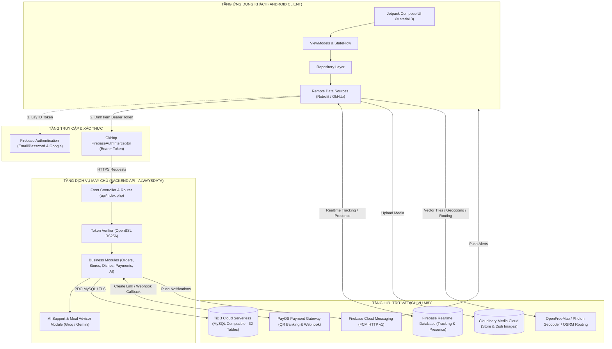

# PHÂN TÍCH KIẾN TRÚC HỆ THỐNG (SYSTEM ARCHITECTURE ANALYSIS)

## 1. Mô hình kiến trúc phân tầng tổng thể

Hệ thống FoodHub được thiết kế theo mô hình kiến trúc phân tán đa tầng (Multi-tier Distributed Client-Server Architecture):

---

## 2. Phân tích chi tiết từng tầng kiến trúc

### 2.1. Tầng Khách (Android Client Architecture - MVVM)
- **View (Giao diện Jetpack Compose):** Hoàn toàn sử dụng các hàm `@Composable`, triệt để loại bỏ XML layouts truyền thống. Giao diện được tổ chức theo từng vai trò rõ rệt: `feature/customer`, `feature/restaurant`, `feature/shipper`, `feature/admin`.
- **ViewModel (Quản lý trạng thái giao diện):** Sử dụng `ViewModel` từ AndroidX Lifecycle kết hợp cùng `StateFlow` và `MutableStateFlow` để đảm bảo luồng dữ liệu 1 chiều (Unidirectional Data Flow - UDF). Trạng thái UI tự động phục hồi khi xoay màn hình hoặc chuyển hướng.
- **Repository (Tầng điều phối dữ liệu):** Đóng vai trò là Single Source of Truth (nguồn dữ liệu chân thực duy nhất), trừu tượng hóa việc lấy dữ liệu từ mạng hoặc cơ sở dữ liệu cục bộ cho ViewModel.
- **Network Layer (Tầng mạng):** Triển khai qua `FoodHubApi` (Retrofit) kết hợp `FirebaseAuthInterceptor`. Interceptor này tự động kiểm tra phiên đăng nhập Firebase của người dùng hiện tại, yêu cầu token mới và đính kèm vào Header `Authorization: Bearer <token>` của mỗi truy vấn.

### 2.2. Tầng Máy chủ (Backend Architecture)
- **Cơ chế Front Controller Router:** Tệp `backend/api/index.php` tiếp nhận toàn bộ các yêu cầu HTTP thông qua cấu hình `.htaccess`. Bộ router phân tích đường dẫn URL thành các tài nguyên (`$resource`) và định danh (`$id`), kiểm tra HTTP Method tương ứng.
- **Bảo mật và Phân quyền phi trạng thái (Stateless Authorization):**
  - Mọi yêu cầu nghiệp vụ đều phải đi qua hàm `verifyToken()` để xác thực chữ ký số RS256 của Firebase ID Token dựa trên khóa công khai được tải từ Google và lưu đệm 1 giờ trong cache.
  - Sau khi xác thực danh tính `firebase_uid`, hàm `account()` sẽ truy vấn bảng `users` trên TiDB để lấy `users.id` và quyền thực tế (`customer`, `seller`, `driver`, `admin`).
  - Hệ thống áp dụng nguyên tắc kiểm tra quyền sở hữu dữ liệu (Data Ownership Enforcement) nghiêm ngặt: Khách hàng chỉ xem/hủy đơn của mình, Quán chỉ sửa món của quán mình, Shipper chỉ xem đơn được phân công, Admin có quyền kiểm soát toàn hệ thống.

### 2.3. Tầng Dữ liệu và Dịch vụ Phụ trợ (Cloud Infrastructure)
- **TiDB Cloud Serverless:** Lưu trữ dữ liệu quan hệ nghiệp vụ chính (hồ sơ, quán ăn, thực đơn món, đơn hàng, hóa đơn, thông báo, nhật ký hoạt động). Kết nối sử dụng TLS với chứng chỉ gốc `ISRG Root X1`, múi giờ phiên làm việc đồng bộ `+07:00`.
- **Firebase Realtime Database:** Đóng vai trò lưu trữ các trạng thái tạm thời, thay đổi với tần suất cao mà cơ sở dữ liệu quan hệ không tối ưu:
  - Tọa độ GPS tài xế di chuyển: `tracking/{orderId}`.
  - Trạng thái trực tuyến / ngoại tuyến: `presence/{uid}` sử dụng cơ chế `onDisconnect`.
  - Trạng thái đang gõ phím trong hội thoại: `chat/{conversationId}/typing/{uid}`.
- **Cloudinary:** Quản lý lưu trữ tập trung hình ảnh đại diện người dùng, logo quán ăn, ảnh bìa quán và hình ảnh chụp thực tế của từng món ăn.
- **Cổng thanh toán PayOS:** Tích hợp giao dịch thanh toán chuyển khoản qua mã VietQR, xác thực tính toàn vẹn của thông báo Webhook bằng thuật toán băm HMAC-SHA256.
