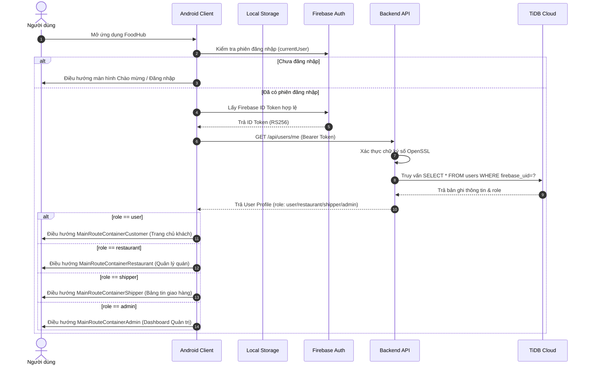
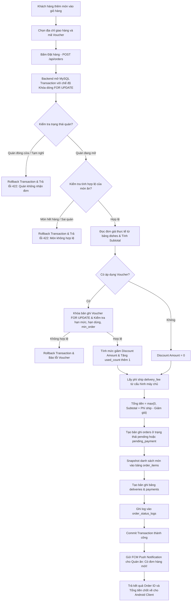
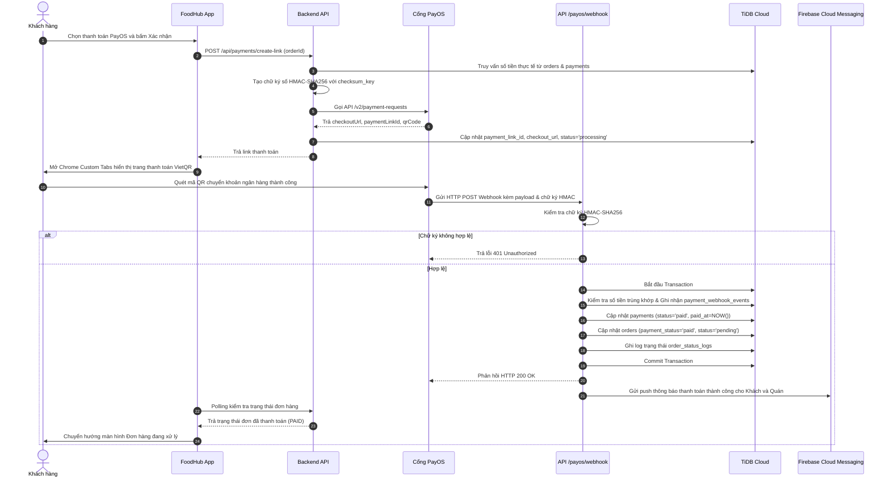
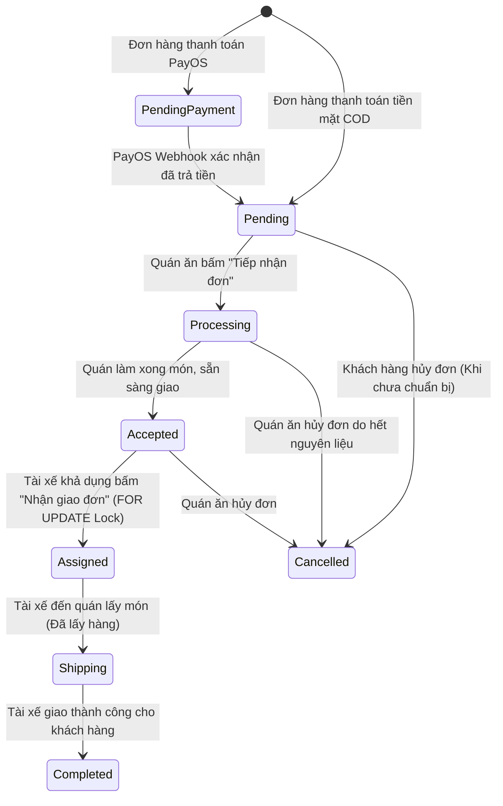

# PHÂN TÍCH CÁC LUỒNG NGHIỆP VỤ HỆ THỐNG (BUSINESS FLOW ANALYSIS)

## 1. Luồng Khởi động và Định tuyến Vai trò (App Startup & Role Routing)

---

## 2. Luồng Đặt hàng và Tính toán Giá trị Đơn hàng (Order Placement Flow)

Hệ thống FoodHub áp dụng nguyên tắc **Chốt giá và kiểm tra tính hợp lệ tại Máy chủ (Server-side Price & Rule Enforcement)**:

---

## 3. Luồng Thanh toán Trực tuyến qua Cổng PayOS (Online Payment Flow)

---

## 4. Luồng Vận chuyển và Giao nhận Hàng (Delivery Lifecycle)

- **Chi tiết cơ chế chống tranh chấp nhận đơn:** Khi tài xế bấm nút "Nhận đơn", Backend khởi tạo một Transaction với câu lệnh:
  `SELECT d.order_id FROM deliveries d JOIN orders o ON o.id=d.order_id WHERE d.order_id=? AND d.driver_id IS NULL AND o.status='accepted' FOR UPDATE`
  Nếu đơn hàng đã bị tài xế khác nhận trước dù chỉ vài phần nghìn giây, câu lệnh sẽ trả về rỗng và hệ thống tự động Rollback, trả về mã lỗi `409 Conflict: Đơn vừa được nhận hoặc không còn khả dụng`.
