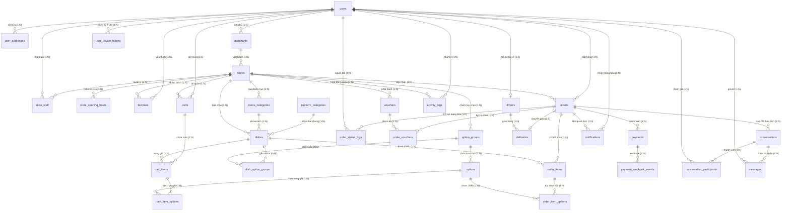

# PHÂN TÍCH CƠ SỞ DỮ LIỆU TOÀN DIỆN (DATABASE ANALYSIS)

## 1. Môi trường Cơ sở Dữ liệu Thực tế
- **Hệ quản trị CSDL:** TiDB Cloud Serverless (phiên bản tương thích hoàn toàn MySQL 8.0: `8.0.11-TiDB-v8.5.3-serverless`).
- **Tên cơ sở dữ liệu hoạt động:** `food_delivery_app`.
- **Mã hóa ký tự:** `utf8mb4`, Collation: `utf8mb4_unicode_ci`, Storage Engine: `InnoDB`.
- **Bảo mật kết nối:** Bắt buộc mã hóa đường truyền TLS (SSL) với chứng chỉ CA `ISRG Root X1`. Múi giờ phiên làm việc đồng bộ `+07:00`.
- **Tổng số bảng dữ liệu:** 32 bảng được định nghĩa chuẩn xác trong `backend/database/schema.sql`.

---

## 2. Sơ đồ Quan hệ Thực thể Toàn diện (Full ERD Diagram)

---

## 3. Danh mục và Đặc tả 32 Bảng Cơ sở Dữ liệu

| STT | Tên bảng | Khóa chính (PK) | Khóa ngoại (FK) | Chức năng nghiệp vụ & Mức sử dụng |
| :---: | :--- | :--- | :--- | :--- |
| 1 | `users` | `id` (BIGINT AUTO) | Không | Lưu trữ hồ sơ người dùng, Firebase UID (`uq_users_firebase_uid`), email, số điện thoại, vai trò (`role: customer, seller, driver, admin`), trạng thái tài khoản. |
| 2 | `user_addresses` | `id` (BIGINT AUTO) | `user_id` -> `users(id)` | Danh sách sổ địa chỉ nhận hàng của khách hàng, gồm tên người nhận, SĐT, địa chỉ chi tiết, tọa độ GPS (lat/lng) và cờ `is_default`. |
| 3 | `merchants` | `id` (BIGINT AUTO) | `owner_user_id` -> `users(id)` | Pháp nhân kinh doanh hoặc thương hiệu chủ quản, liên kết trực tiếp với tài khoản chủ quán (`seller`). |
| 4 | `stores` | `id` (BIGINT AUTO) | `merchant_id` -> `merchants(id)` | Cửa hàng/quán ăn thực tế: Tên quán, mô tả, logo, ảnh bìa, địa chỉ, tọa độ lấy hàng, giờ mở/đóng cửa, trạng thái mở quán (`is_open`), điểm đánh giá. |
| 5 | `store_staff` | `id` (BIGINT AUTO) | `store_id`, `user_id` | Quản lý nhân viên thuộc cửa hàng với các quyền `owner`, `manager`, `staff`. |
| 6 | `store_opening_hours`| `id` (BIGINT AUTO) | `store_id` -> `stores(id)` | Cấu hình chi tiết khung giờ mở/đóng cửa theo từng thứ trong tuần (từ thứ 2 đến Chủ nhật). |
| 7 | `favorites` | `(user_id, store_id)` | `user_id`, `store_id` | Danh sách quán ăn yêu thích được khách hàng đánh dấu lưu lại. |
| 8 | `platform_categories`| `id` (BIGINT AUTO) | Không | Danh mục ngành hàng cấp hệ thống (ví dụ: Cơm, Bún/Phở, Trà sữa, Đồ ăn vặt). |
| 9 | `menu_categories` | `id` (BIGINT AUTO) | `store_id` -> `stores(id)` | Nhóm phân loại món ăn riêng biệt do từng quán ăn tự tạo trong thực đơn của mình. |
| 10 | `dishes` | `id` (BIGINT AUTO) | `store_id`, `menu_category_id`, `platform_category_id` | Món ăn: Tên món, đơn giá, giá gốc, hình ảnh Cloudinary, mô tả, số lượng tồn kho, trạng thái còn bán (`is_available`). |
| 11 | `option_groups` | `id` (BIGINT AUTO) | `store_id` -> `stores(id)` | Nhóm các tùy chọn của món ăn (ví dụ: Chọn kích cỡ Size, Mức đường, Mức đá, Món ăn kèm). |
| 12 | `options` | `id` (BIGINT AUTO) | `option_group_id` -> `option_groups(id)` | Tùy chọn chi tiết cụ thể (ví dụ: Size L phụ thu 10.000đ, Trân châu phụ thu 5.000đ). |
| 13 | `dish_option_groups`| `(dish_id, option_group_id)` | `dish_id`, `option_group_id` | Bảng liên kết trung gian gắn các nhóm tùy chọn vào từng món ăn cụ thể. |
| 14 | `vouchers` | `id` (BIGINT AUTO) | `store_id` -> `stores(id)` (NULL nếu toàn sàn) | Quản lý mã giảm giá: Mã code, loại giảm (`percentage`, `fixed`, `free_shipping`), giá trị giảm, giảm tối đa, đơn tối thiểu, số lượng giới hạn và lượt đã dùng. |
| 15 | `carts` | `id` (BIGINT AUTO) | `user_id`, `store_id`, `address_id`, `voucher_id` | Bảng lưu giỏ hàng trên server (dự phòng, hiện tại Client quản lý qua `CartViewModel`). |
| 16 | `cart_items` | `id` (BIGINT AUTO) | `cart_id`, `dish_id` | Các món ăn nằm trong giỏ hàng lưu server. |
| 17 | `cart_item_options` | `(cart_item_id, option_id)` | `cart_item_id`, `option_id` | Các tùy chọn đi kèm cho từng món ăn trong giỏ hàng server. |
| 18 | `orders` | `id` (BIGINT AUTO) | `customer_id`, `store_id` | Bản ghi đơn hàng chính: Mã đơn (`code`), trạng thái (`status`), snapshot địa chỉ giao, tổng tiền, tiền món, phí giao hàng, giảm giá, phương thức thanh toán, mốc thời gian. |
| 19 | `order_items` | `id` (BIGINT AUTO) | `order_id`, `dish_id` | Bản ghi chụp nhanh (snapshot) thông tin món lúc đặt: Tên món, số lượng, đơn giá tại thời điểm chốt đơn, tổng tiền dòng. |
| 20 | `order_item_options`| `id` (BIGINT AUTO) | `order_item_id`, `option_id` | Snapshot các tùy chọn đi kèm món ăn tại thời điểm đặt đơn. |
| 21 | `order_status_logs` | `id` (BIGINT AUTO) | `order_id`, `actor_user_id` | Nhật ký ghi vết lịch sử chuyển đổi trạng thái của đơn hàng cùng người thực hiện và ghi chú. |
| 22 | `order_vouchers` | `(order_id, voucher_id)`| `order_id`, `voucher_id` | Lưu vết chi tiết mã voucher và số tiền giảm giá thực tế áp dụng cho từng đơn hàng. |
| 23 | `payments` | `id` (BIGINT AUTO) | `order_id` -> `orders(id)` | Bản ghi giao dịch thanh toán: Nhà cung cấp (`payos`, `cash`), phương thức, mã đơn PayOS, link thanh toán, mã giao dịch ngân hàng, số tiền, trạng thái (`pending`, `paid`, `refunded`). |
| 24 | `payment_webhook_events`| `id` (BIGINT AUTO) | `payment_id` -> `payments(id)` | Nhật ký tiếp nhận Webhook từ cổng thanh toán PayOS để đối soát và chống tấn công Replay. |
| 25 | `drivers` | `id` (BIGINT AUTO) | `user_id` -> `users(id)` | Hồ sơ tài xế: Loại phương tiện, biển số xe, trạng thái làm việc (`offline`, `available`, `busy`), điểm đánh giá và tổng số chuyến đã hoàn thành. |
| 26 | `deliveries` | `id` (BIGINT AUTO) | `order_id`, `driver_id` -> `drivers(id)` | Chuyến giao hàng: Gắn tài xế nhận đơn, trạng thái chuyến đi (`unassigned`, `assigned`, `accepted`, `picked_up`, `delivered`), phí giao hàng, mốc lấy hàng và giao xong. |
| 27 | `conversations` | `id` (BIGINT AUTO) | `order_id`, `created_by` | Cuộc hội thoại tin nhắn: Phân loại (`customer_store`, `customer_driver`, `support`), trạng thái mở/đóng. |
| 28 | `conversation_participants`| `(conversation_id, user_id)` | `conversation_id`, `user_id` | Danh sách thành viên tham gia hội thoại và mốc thời gian đọc tin nhắn gần nhất (`last_read_at`). |
| 29 | `messages` | `id` (BIGINT AUTO) | `conversation_id`, `sender_user_id` | Nội dung tin nhắn: Loại tin nhắn (`text`, `image`), nội dung chữ, đường dẫn ảnh Cloudinary, trạng thái đã phát (`is_delivered`) và đã xem (`is_seen`). |
| 30 | `notifications` | `id` (BIGINT AUTO) | `user_id`, `related_order_id` | Hộp thư thông báo lưu lâu dài của người dùng: Tiêu đề, nội dung tóm tắt, loại thông báo, trạng thái đã đọc (`is_read`). |
| 31 | `user_device_tokens` | `id` (BIGINT AUTO) | `user_id` -> `users(id)` | Quản lý mã định danh thiết bị (FCM Device Token) để phục vụ gửi thông báo đẩy Firebase Cloud Messaging. |
| 32 | `activity_logs` | `id` (BIGINT AUTO) | `actor_user_id`, `store_id` | Nhật ký ghi nhận các hành vi vận hành quan trọng của chủ quán hoặc quản trị viên trong hệ thống. |
