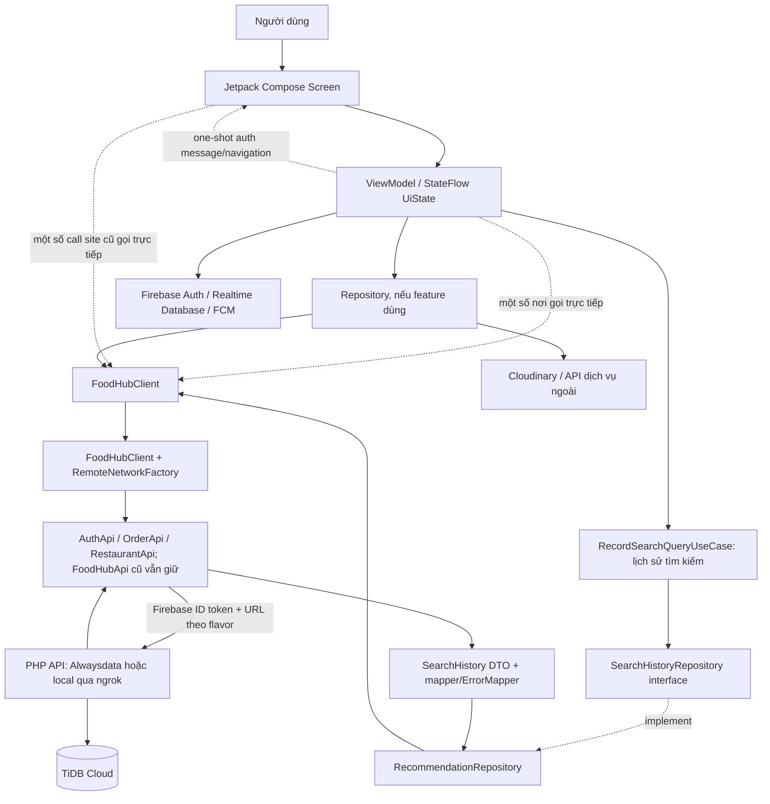
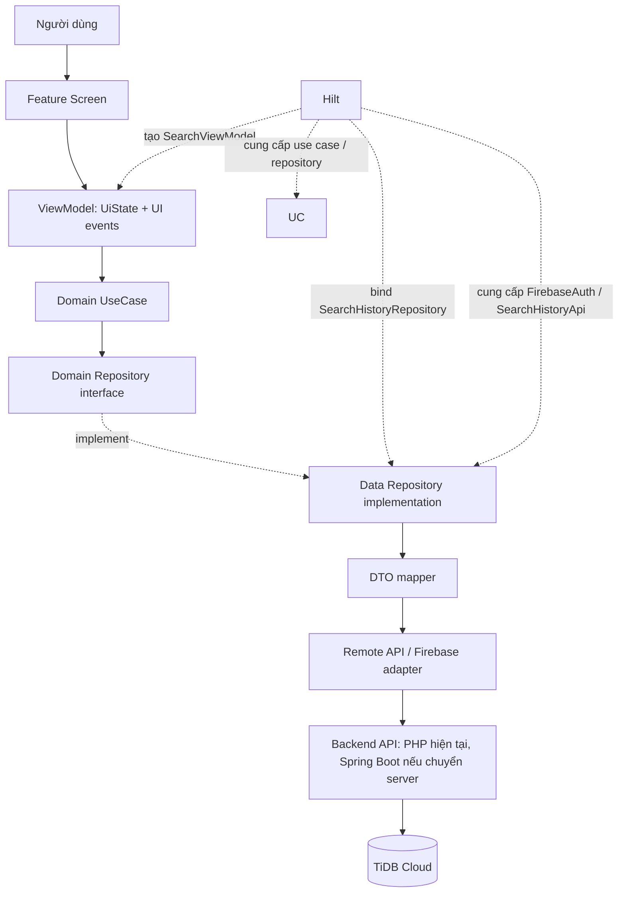

# Kiến trúc Android — trạng thái khảo sát

Cập nhật: 26/11/2026. Network/config, domain, DTO/error, Hilt và các lát auth, customer search/home/cart presentation đã qua build/unit test. Cart đã dùng `CartUiState`/`StateFlow`, nhưng vẫn gọi API/Firebase trực tiếp; các feature khác vẫn chưa chuyển.

## Hiện trạng

Hiện trạng là kiến trúc phân lớp một phần, chưa phải Clean Architecture hoàn chỉnh: domain có `SearchQuery`, `SearchHistoryRepository` và `RecordSearchQueryUseCase` cho lịch sử tìm kiếm; auth, customer search, customer home và Cart dùng state qua `StateFlow<UiState>`, auth phát one-shot events. Cart vẫn gọi API/Firebase trực tiếp từ ViewModel/Screen. `di/` cung cấp Hilt cho các ViewModel đã migrate; phần lớn feature khác chưa theo một đường truy cập dữ liệu duy nhất.

Network đã có một điểm tạo Retrofit/OkHttp chung. Logger an toàn chỉ bật ở debug. `FoodHubClient` vẫn phục vụ caller cũ và cả truy vấn danh sách quán/món ở SearchViewModel; lịch sử tìm kiếm riêng đi qua DTO/mapper/repository. Hilt tạo SearchViewModel/AuthViewModel và cấp use case/repository cho lịch sử tìm kiếm. AuthViewModel vẫn gọi Firebase/API trực tiếp; tách các use case/repository khác sẽ làm theo từng feature.

## Đích sau refactor (chưa triển khai)

Quy tắc đích: Screen chỉ hiển thị và chuyển thao tác; ViewModel giữ state và gọi use case; domain không phụ thuộc Android/Retrofit/Firebase; data chuyển đổi DTO/domain và thực hiện truy cập nguồn dữ liệu. Backend xác thực và thực thi quy tắc bảo mật/nghiệp vụ; client không được xem là ranh giới bảo mật.

## Liên kết

- Kết quả khảo sát và lộ trình: [REFACTOR_NOTES.md](REFACTOR_NOTES.md)
- Cấu trúc/tổng quan dự án: [README.md](../README.md)
- Luồng nghiệp vụ: [WORKFLOWS.md](WORKFLOWS.md)
