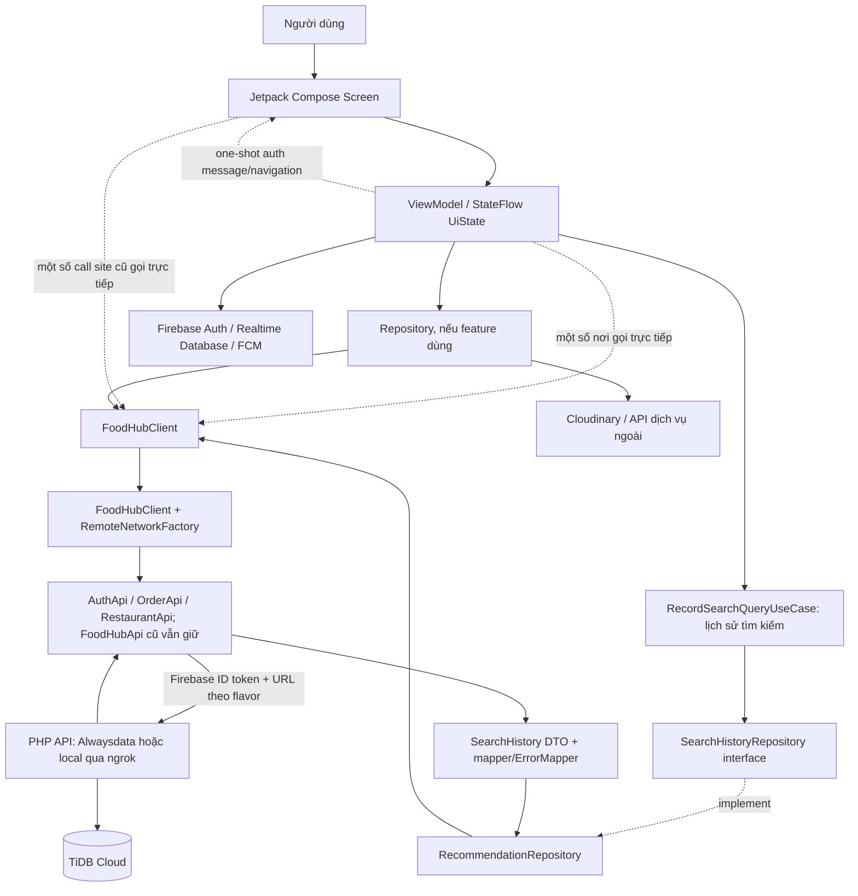
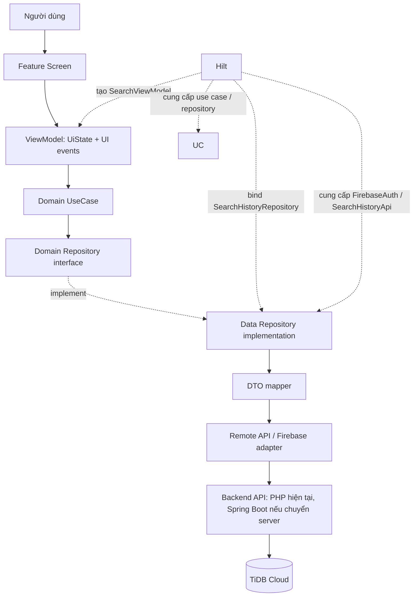

# Kiến trúc Android — trạng thái khảo sát

Cập nhật: 26/11/2026. Giai đoạn 1 network, Giai đoạn 2 domain, Giai đoạn 3 DTO/error, Giai đoạn 4 Hilt và lát auth của Giai đoạn 5 đã qua build/unit test; các feature khác vẫn chưa chuyển.

## Hiện trạng

Hiện trạng là kiến trúc phân lớp một phần, chưa phải Clean Architecture hoàn chỉnh: domain có `SearchQuery`, `SearchHistoryRepository` và `RecordSearchQueryUseCase` cho lịch sử tìm kiếm; auth có `AuthUiState` và one-shot events. `di/` cung cấp Hilt cho SearchViewModel và AuthViewModel, còn phần lớn Screen/ViewModel/Repository chưa tuân theo một đường truy cập dữ liệu duy nhất.

Network đã có một điểm tạo Retrofit/OkHttp chung. Logger an toàn chỉ bật ở debug. Manifest chính chặn cleartext; source set debug có overlay cho phép cleartext nếu backend local dùng HTTP. Các API service nhóm đã được khai báo, còn `FoodHubApi` tổng quát được giữ để chuyển caller dần mà không đổi hành vi. DTO/mapper/ErrorMapper hiện được dùng cho riêng luồng lịch sử tìm kiếm; các API cũ chưa được chuyển. Hilt tạo SearchViewModel/AuthViewModel và cấp use case/repository cho lịch sử tìm kiếm; Retrofit vẫn được lấy từ `FoodHubClient` singleton trong giai đoạn chuyển tiếp. AuthViewModel còn gọi Firebase/API trực tiếp; tách AuthUseCase/Repository sẽ làm trong giai đoạn sau.

## Đích sau refactor (chưa triển khai)

Quy tắc đích: Screen chỉ hiển thị và chuyển thao tác; ViewModel giữ state và gọi use case; domain không phụ thuộc Android/Retrofit/Firebase; data chuyển đổi DTO/domain và thực hiện truy cập nguồn dữ liệu. Backend xác thực và thực thi quy tắc bảo mật/nghiệp vụ; client không được xem là ranh giới bảo mật.

## Liên kết

- Kết quả khảo sát và lộ trình: [REFACTOR_NOTES.md](REFACTOR_NOTES.md)
- Cấu trúc/tổng quan dự án: [README.md](../README.md)
- Luồng nghiệp vụ: [WORKFLOWS.md](WORKFLOWS.md)
