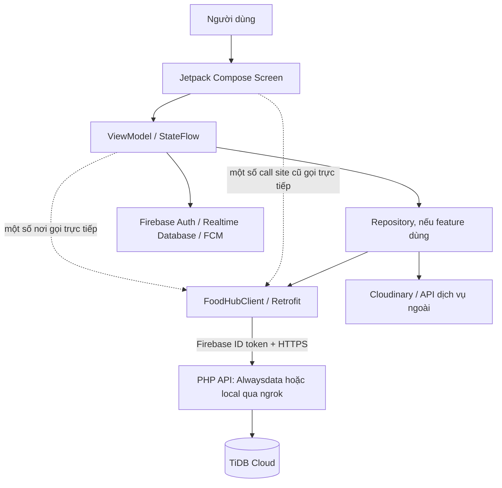
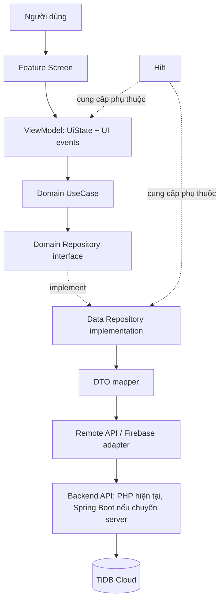

# Kiến trúc Android — trạng thái khảo sát

Cập nhật: 26/11/2026. Tài liệu mô tả hiện trạng và đích refactor; phần đích không có nghĩa là đã triển khai.

## Hiện trạng

Hiện trạng là kiến trúc phân lớp một phần, chưa phải Clean Architecture hoàn chỉnh: `domain/`, `di/` và `data/mapper/` đang rỗng; không có Hilt; Screen/ViewModel/Repository chưa tuân theo một đường truy cập dữ liệu duy nhất.

## Đích sau refactor (chưa triển khai)

Quy tắc đích: Screen chỉ hiển thị và chuyển thao tác; ViewModel giữ state và gọi use case; domain không phụ thuộc Android/Retrofit/Firebase; data chuyển đổi DTO/domain và thực hiện truy cập nguồn dữ liệu. Backend xác thực và thực thi quy tắc bảo mật/nghiệp vụ; client không được xem là ranh giới bảo mật.

## Liên kết

- Kết quả khảo sát và lộ trình: [REFACTOR_NOTES.md](REFACTOR_NOTES.md)
- Cấu trúc/tổng quan dự án: [README.md](../README.md)
- Luồng nghiệp vụ: [WORKFLOWS.md](WORKFLOWS.md)
