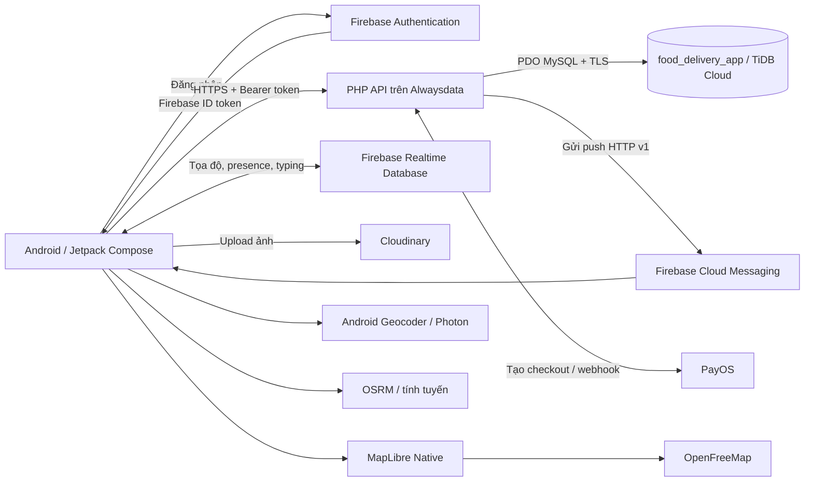

# Kiến trúc và công nghệ

Cập nhật: 14/11/2026. Nguồn xác thực: mã nguồn và cấu hình API đang chạy, không chỉ dựa vào lịch sử hội thoại.

## 1. Các thành phần

TiDB Cloud là nguồn dữ liệu nghiệp vụ chính, truy cập qua giao thức MySQL. MariaDB local được giữ làm bản trước chuyển đổi. Firebase UID là cầu nối danh tính, không phải khóa chính của mọi bảng. Realtime Database không thay thế lịch sử đơn hàng hoặc thanh toán trong database nghiệp vụ.

## 2. Công nghệ Android

| Thành phần | Công nghệ / khai báo hiện tại |
| --- | --- |
| Ngôn ngữ | Kotlin; catalog khai báo phiên bản plugin Compose 2.0.21 |
| Giao diện | Jetpack Compose, Material 3, Compose BOM 2024.09.00; còn có khai báo UI trực tiếp trong catalog |
| Tổ chức màn hình | `feature/`, ViewModel, Compose State, StateFlow, Kotlin Coroutines |
| Điều hướng | Navigation Compose 2.8.5; `MainActivity` và container theo vai trò |
| HTTP / JSON | Retrofit 2.9.0, OkHttp 4.12.0, Gson |
| Auth | Firebase Authentication; Google Credential Manager và Google ID token |
| Ảnh | Cloudinary Android SDK, Coil |
| Bản đồ | MapLibre Native Android 13.7.1, style OpenFreeMap Liberty |
| Vị trí máy | Fused Location Provider / Play services location 21.2.0 |
| Tìm địa chỉ | Photon; reverse lookup ưu tiên Android Geocoder, Photon dự phòng |
| Tính tuyến | Các endpoint OSRM trong `ShipperViewModel.fetchOSRMRoute` |
| Kiểm thử | JUnit 4.13.2; có cấu hình AndroidX instrumentation và Compose UI tests |
| Build | Android Gradle Plugin 9.0.1, Gradle wrapper 9.1.0 |
| Android | `minSdk=29`, `compileSdk=36`, `targetSdk=36`; bytecode Java 11 |

Các phiên bản trên là **khai báo nguồn**. Một số thư viện được khai báo cả trực tiếp và qua catalog/BOM; phiên bản thực sự được Gradle chọn phải kiểm tra bằng dependency report. Không suy ra phiên bản Kotlin của toàn dự án chỉ từ compiler đã có trong cache.

`osmdroid` vẫn còn dependency và `GeoPoint` cho dữ liệu tuyến; bản đồ shipper và bộ chọn địa chỉ đang hiển thị bằng MapLibre. Có dependency/type Firebase cũ không có nghĩa nghiệp vụ vẫn ghi vào Firestore.

## 3. Backend và database

- PHP online chạy trên Alwaysdata (CLI đã kiểm tra 8.4.27), sử dụng PDO MySQL, OpenSSL, JSON và cURL/HTTPS streams.
- API chính `https://chinh.alwaysdata.net/food-delivery-api/api/`; public `/home/chinh/www/food-delivery-api`, config/service account/CA/cache ngoài web tại `/home/chinh/private/foodhub`. PHP timezone Asia/Ho_Chi_Minh, session database +07:00.
- API hiện tập trung trong `backenddd/api/index.php`; chưa phải Laravel hoặc một backend tách service/controller đầy đủ.
- Database đang dùng: TiDB Cloud `8.0.11-TiDB-v8.5.3-serverless`, **`food_delivery_app`**, 32 bảng; TLS xác minh bằng ISRG Root X1 và session timezone `+07:00`. `backenddd/database/connection.php` dùng chung cho API và công cụ kiểm tra CLI.
- Bản import `food_delivery` trên TiDB thiếu AUTO_INCREMENT của 27 bảng; đã tạo database mới từ DDL local, chép dữ liệu giữ ID và xác minh trước chuyển cấu hình. Không dùng bản import đó cho ghi dữ liệu ứng dụng.
- MariaDB 10.4.32 local giữ nguyên để đối chiếu/khôi phục; không tự đồng bộ hai chiều với TiDB.
- `backenddd/database/schema.sql` định nghĩa quan hệ, khóa ngoại, unique key, trạng thái và dữ liệu khởi tạo có trong file.
- Bản backend đang chạy và bản nguồn là **hai thư mục khác nhau**. Các cấu hình và cache theo máy không được coi là mã nguồn có thể sao chép mù quáng.

## 4. Quyền và danh tính

| Vai trò nghiệp vụ | Giá trị trong DB | API trả về cho Android | Route chính |
| --- | --- | --- | --- |
| Khách hàng | `customer` | `user` | `main_user` |
| Nhà hàng | `seller` | `restaurant` | `main_restaurant` |
| Shipper | `driver` | `shipper` | `main_shipper` |
| Admin | `admin` | `admin` | `main_admin` |

`AuthViewModel` xác thực bằng Firebase, sau đó lấy hồ sơ MySQL. `MainActivity` có bộ nhớ vai trò gắn với Firebase UID để khôi phục phiên. API đọc quyền từ bảng `users`; không dựa vào nhãn giao diện hay Firebase custom claims để cấp quyền hiện tại.

## 5. Đồng bộ dữ liệu

| Dữ liệu | Nơi lưu chính | Cách cập nhật hiện tại |
| --- | --- | --- |
| Hồ sơ, địa chỉ, quán, món, đơn, voucher | MySQL/MariaDB | API; nhiều danh sách polling |
| Lịch sử chat, thành viên hội thoại | MySQL/MariaDB | API; hội thoại khoảng 3 giây, tin nhắn khoảng 2 giây |
| Menu nhà hàng | MySQL/MariaDB | Polling khoảng 5 giây; có cập nhật state sau thao tác ở các luồng quản lý |
| Đơn shipper đang giao / đơn trống | MySQL/MariaDB | Polling khoảng 4 giây |
| Lịch sử và thu nhập shipper | MySQL/MariaDB | Polling khoảng 10 giây, có làm mới thủ công |
| Tọa độ trực tiếp | RTDB `tracking/{orderId}` | Location callback, listener realtime |
| Online/offline | RTDB `presence/{uid}` | PresenceManager, `onDisconnect` |
| Đang nhập chat | RTDB `chat/{conversationId}/typing/{uid}` | Ghi trạng thái tạm thời |
| Thông báo lưu lại | MySQL `notifications` | API ghi sự kiện, app lấy hộp thư |
| Push | FCM | PHP gọi HTTP v1 tới token của người nhận |
| Ảnh | Cloudinary | Upload ảnh trước, lưu URL trong MySQL |

FCM không tự cập nhật mọi StateFlow. RTDB cũng chưa đồng bộ toàn bộ bảng MySQL. Cần đọc đúng luồng trước khi sửa một màn hình đang dùng polling.

## 6. Thiết kế

- Tông trắng/xanh, màu chính thường là `#2159BC`, nền `#F5F8FC` / `#F8F9FA`.
- Dùng tiếng Việt đồng bộ cho nhãn, điều hướng, trạng thái và form.
- Stitch project `17203895360811157884`: “Food Delivery PRD (Vietnamese)”.
- Mẫu thu nhập mới: “Thu nhập giao hàng (Shipper)”, screen `3aeab867043b4da399712cc64071cbfa`.
- Mẫu thiết kế là tham chiếu; số liệu minh họa trong Stitch không được đưa thành dữ liệu thật trong app.
