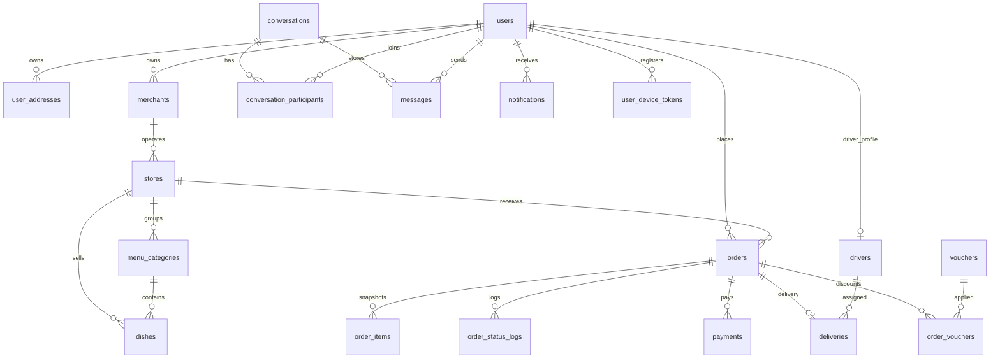

# Database FoodHub

## Nguồn định nghĩa và môi trường

- Database **đang dùng: `food_delivery_app` trên TiDB Cloud**, bộ ký tự `utf8mb4`, schema mặc định `utf8mb4_unicode_ci`, các bảng khai báo InnoDB. `food_delivery` là tên schema gốc và bản MariaDB cũ.
- Engine local kiểm tra ngày 12/11/2026: **10.4.32-MariaDB**, tổng cộng **32 bảng**.
- Từ **14/11/2026**, API dùng **TiDB Cloud 8.0.11-TiDB-v8.5.3-serverless / food_delivery_app**, 32 bảng. Đã bổ sung phần local phát sinh sau lần import; đối chiếu khóa/dấu băm dữ liệu toàn bộ 32 bảng trước chuyển API. Tại thời điểm chuyển: users=5, stores=1, dishes=4, orders=6. Giữ nguyên ID và Firebase UID, không xóa DB local.
- Bản import TiDB `food_delivery` có dữ liệu nhưng mất AUTO_INCREMENT ở 27 bảng. Vì [TiDB không hỗ trợ thêm lại thuộc tính này bằng ALTER](https://docs.pingcap.com/tidb/stable/auto-increment/), đã tạo `food_delivery_app` bằng SHOW CREATE TABLE từ MariaDB, chép dữ liệu TiDB hiện tại giữ nguyên khóa và xác minh tất cả bảng. Cả hai bản cũ vẫn còn. Công cụ check-database phát hiện các cột primary `id` thiếu tự tăng để tránh coi chỉ đủ 32 bảng là đã sẵn sàng.
- DDL chuẩn của repo: [`backenddd/database/schema.sql`](../backenddd/database/schema.sql).
- Migration hiện có: [`2026_11_12_shipper_profile.sql`](../backenddd/migration/2026_11_12_shipper_profile.sql), thêm `users.address_line` cho DB cũ. Schema mới đã có cột này; không chạy ALTER lặp lại khi cột đã tồn tại.
- Dòng chú thích “MySQL 8” đầu file DDL không có nghĩa máy local đang chạy MySQL 8.
- Schema có `CREATE TABLE IF NOT EXISTS`; import lại không tự nâng cấp các cột của bảng đã tồn tại và không phải lệnh reset dữ liệu.

## 1. Quy ước

- Phần lớn khóa chính là số `BIGINT UNSIGNED`. API thường trả khóa số dưới dạng chuỗi để khớp model Android.
- `users.firebase_uid` là unique và liên kết Firebase Authentication. Không có cột mật khẩu trong MySQL.
- Các khóa ngoại `user_id`, `customer_id`, `driver_id`, `store_id` tham chiếu khóa số MySQL, không phải Firebase UID.
- `driver_id` trong `deliveries` tham chiếu `drivers.id`; `drivers.user_id` mới tham chiếu `users.id`.
- API trả `Order.shipperId` là Firebase UID của người giao, dùng để kiểm tra/tổng hợp phía Android.
- Trạng thái trong DB chủ yếu là chữ thường. Model đơn hàng và thanh toán Android thường dùng chữ hoa qua lớp ánh xạ API.
- Tiền lưu bằng `DECIMAL(12,2)` ở các bảng nghiệp vụ. UI dùng VND và thường định dạng không có phần lẻ.
- Tọa độ địa chỉ/quán/đơn có thể null. Không dùng một tọa độ mẫu cố định như dữ liệu GPS thật.
- Xóa mềm có ở một số bảng qua `deleted_at`; không phải mọi endpoint DELETE đều xóa mềm.

## 2. Sơ đồ quan hệ chính



Sơ đồ này chỉ trình bày quan hệ chính. Khóa ngoại, unique key và quy tắc xóa chính xác nằm trong DDL.

## 3. Danh mục đủ 32 bảng

“Có luồng” nghĩa là đã tìm thấy API hoặc code sử dụng, không khẳng định mọi thao tác đã qua kiểm thử end-to-end.

| # | Bảng | Vai trò và liên kết | Mức sử dụng hiện tại |
| --- | --- | --- | --- |
| 1 | `users` | Hồ sơ, Firebase UID, email, role, trạng thái, avatar, địa chỉ hồ sơ | Có luồng auth/profile/admin |
| 2 | `user_addresses` | Địa chỉ nhận hàng, tên/sđt người nhận, tọa độ, mặc định; FK user | Có luồng khách hàng |
| 3 | `merchants` | Chủ kinh doanh; FK `owner_user_id` | API tạo cùng quán |
| 4 | `stores` | Quán, hình ảnh, liên hệ, giờ hoạt động, địa chỉ/tọa độ; FK merchant | Có luồng nhà hàng/khách |
| 5 | `store_staff` | Thành viên và quyền nhân viên theo quán | Có trong schema, chưa có endpoint quản lý riêng |
| 6 | `store_opening_hours` | Giờ hoạt động từng ngày trong tuần | Có trong schema; form hiện dùng giờ trên `stores` |
| 7 | `favorites` | Khách yêu thích quán; khóa ghép user/store | Chưa có endpoint favorites riêng trong router |
| 8 | `platform_categories` | Danh mục chung; món có thể tham chiếu | Có cấu trúc/FK, chưa có CRUD danh mục riêng |
| 9 | `menu_categories` | Danh mục menu của quán | API món có thể tìm/tạo theo tên |
| 10 | `dishes` | Món, giá, ảnh, mô tả, còn bán; FK quán/danh mục | Có CRUD món |
| 11 | `option_groups` | Nhóm lựa chọn thêm/bớt cho quán | Chưa có luồng API/UI đầy đủ |
| 12 | `options` | Tùy chọn cụ thể và phụ thu; FK nhóm | Chưa có luồng API/UI đầy đủ |
| 13 | `dish_option_groups` | Gắn nhóm tùy chọn vào món | Chưa có luồng API/UI đầy đủ |
| 14 | `vouchers` | Mã giảm, loại giảm, hạn, giới hạn, lượt dùng, quán tùy chọn | Có luồng admin và đặt hàng |
| 15 | `carts` | Giỏ hàng lưu server, chủ giỏ/quán | Schema dự phòng; giỏ hiện ở CartViewModel |
| 16 | `cart_items` | Dòng món trong giỏ server | Chưa có endpoint giỏ |
| 17 | `cart_item_options` | Tùy chọn của dòng giỏ server | Chưa có endpoint giỏ |
| 18 | `orders` | Đơn, khách/quán, địa chỉ snapshot, tổng tiền, trạng thái và mốc thời gian | Có luồng đặt/giao/thanh toán |
| 19 | `order_items` | Snapshot tên, đơn giá, số lượng món lúc đặt | Server ghi khi tạo đơn |
| 20 | `order_item_options` | Snapshot tùy chọn món đã đặt | Schema dự phòng, chưa có xử lý tùy chọn đầy đủ |
| 21 | `order_status_logs` | Lịch sử đổi trạng thái và người thực hiện | API ghi log |
| 22 | `order_vouchers` | Voucher và số tiền giảm đã áp cho đơn | Server ghi khi tạo đơn |
| 23 | `payments` | Số tiền, phương thức, checkout, payment link, giao dịch và trạng thái | Có API lịch sử/tạo checkout; xem hạn chế webhook |
| 24 | `payment_webhook_events` | Dấu sự kiện gateway, hash và trạng thái xử lý | Có code webhook PayOS |
| 25 | `drivers` | Hồ sơ hoạt động, phương tiện, trạng thái, số chuyến | Có luồng shipper |
| 26 | `deliveries` | Một giao hàng cho đơn, driver nhận, phí, mốc lấy/giao | Có luồng nhận và hoàn tất đơn |
| 27 | `conversations` | Hội thoại khách/quán, khách/shipper hoặc hỗ trợ | Có API chat |
| 28 | `conversation_participants` | Thành viên, thời điểm đọc | Có API chat |
| 29 | `messages` | Nội dung/URL ảnh, người gửi, đã đọc/đã gửi | Có API chat |
| 30 | `notifications` | Hộp thư thông báo lưu lâu dài | Có API và ghi sự kiện |
| 31 | `user_device_tokens` | Token thiết bị phục vụ FCM | Client đăng ký, server dùng gửi push |
| 32 | `activity_logs` | Nhật ký hoạt động, actor/quán | Có API và luồng quản lý quán |

Không có các bảng ví/rút tiền/KYC/đối soát/điểm thưởng/AI recommendation trong schema hiện tại. Không dùng thiết kế minh họa trên Stitch để suy ra các bảng này đã tồn tại.

## 4. Trường và ánh xạ cần nhớ

| Dữ liệu Android/API | Dữ liệu DB | Ý nghĩa |
| --- | --- | --- |
| `User.uid` | `users.firebase_uid` | Danh tính Firebase |
| `User.id` | `users.id` | Khóa hồ sơ MySQL |
| `User.role` | `users.role` qua `externalUser()` | `customer→user`, `seller→restaurant`, `driver→shipper` |
| `address`, `addressDetail` ở API địa chỉ | `user_addresses.address_line` | API hiện trả cả hai từ cùng một cột; UI tránh in trùng |
| `restaurantId` | `stores.id` | API nhận/trả chuỗi, DB là khóa số |
| `Order.time` | `orders.placed_at` | Ngày đặt đơn, không phải ngày thu nhập |
| `Order.completedAt` | `COALESCE(orders.delivered_at, deliveries.delivered_at, log completed)` | Ngày hoàn tất dùng cho biểu đồ shipper |
| `Order.customerLat/Lng` | `orders.delivery_lat/delivery_lng` | Snapshot điểm giao của đơn |
| `Order.restaurantLat/Lng` | `stores.latitude/longitude` qua JOIN | Điểm lấy hàng hiện tại từ quán |
| `Order.shipperId` | `users.firebase_uid` qua drivers/deliveries | UID Firebase, khác `deliveries.driver_id` |
| `shippingFee` | `orders.delivery_fee` | Phí giao hàng, đang được tổng hợp thành thu nhập shipper |
| `isPaid` | `orders.payment_status='paid'` | Trạng thái trả tiền theo server |
| `coverImage`, `avatarUrl` của quán | `stores.cover_url`, `stores.logo_url` | URL Cloudinary |

`deliveries.driver_earning` mặc định 0 và chưa được báo cáo shipper dùng làm thu nhập thực nhận. `drivers.completed_trips` là counter cập nhật khi hoàn tất; biểu đồ hiện đếm đơn hoàn tất thay vì tin hoàn toàn vào counter.

## 5. Trạng thái

| Nhóm | Các giá trị trong DB |
| --- | --- |
| Tài khoản | `active`, `suspended`, `pending` |
| Đơn hàng | `pending_payment`, `pending`, `processing`, `accepted`, `shipping`, `completed`, `cancelled` |
| Trạng thái thanh toán trên đơn | `pending`, `paid`, `failed`, `refunded` |
| Payment | `pending`, `processing`, `paid`, `failed`, `cancelled`, `refunded` |
| Driver | `offline`, `available`, `busy` |
| Delivery | `unassigned`, `assigned`, `accepted`, `picked_up`, `delivered`, `cancelled` |
| Voucher | `discount_type`: `percentage`, `fixed`, `free_shipping`; hoạt động bằng `is_active` và khoảng ngày |
| Conversation | `type`: `customer_store`, `customer_driver`, `support` |

## 6. Kiểm tra dữ liệu không làm thay đổi DB

```sql
USE food_delivery_app;
SELECT VERSION();
SELECT COUNT(*) FROM information_schema.tables WHERE table_schema = DATABASE() AND table_type = 'BASE TABLE';
SELECT role, status FROM users WHERE email = 'admin@gmail.com';
SELECT status, COUNT(*) FROM orders GROUP BY status;
SELECT COUNT(*) FROM orders WHERE status = 'completed' AND delivered_at IS NULL;
```

Muốn kiểm tra schema thực tế, dùng `SHOW CREATE TABLE ten_bang` và so với DDL. Việc có file schema mới trong repo không chứng minh database đang chạy đã được nâng cấp.
