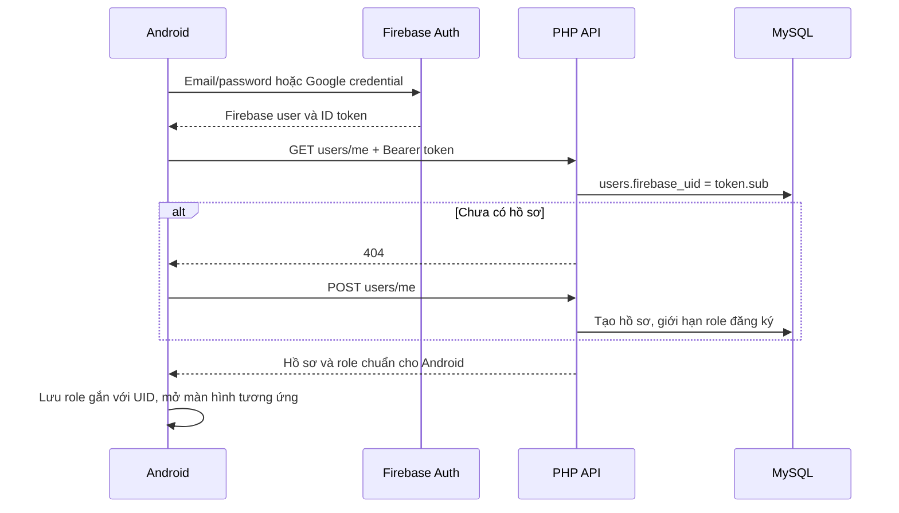
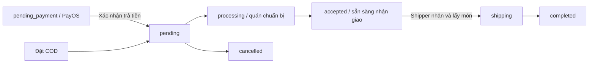

# Các luồng xử lý

## 1. Đăng ký, đăng nhập và hồ sơ

- Email/password và Google đều được Firebase xác thực. Không lưu mật khẩu vào `users`.
- Google dùng Credential Manager → Google ID token → Firebase credential. ID token gọi API là **Firebase ID token**, không phải Google ID token ban đầu.
- Nếu đổi Firebase project, UID mới chưa có trong TiDB. Backend local có thể nối UID mới với hồ sơ cũ khi token chứa email đã được Firebase xác minh và email trùng khớp; việc này giữ nguyên ID, quyền và dữ liệu đơn hàng. Email chưa xác minh không được dùng để nhận hồ sơ cũ.
- Việc Firebase còn tài khoản nhưng MySQL chưa có hồ sơ là tình huống hợp lệ sau chuyển database. Không đăng ký lại cùng email để giải quyết; dùng đăng nhập và đồng bộ `users/me`.
- Đăng ký thông thường chỉ tạo khách hàng/nhà hàng/shipper. Admin được cấp từ môi trường quản trị, không thêm lựa chọn admin vào form đăng ký.
- Tài khoản thử `admin@gmail.com` đã được cập nhật trong Firebase, gán `role=admin`, `status=active` trong MySQL và kiểm tra đăng nhập/API ngày 12/11/2026.

## 2. Chọn địa chỉ của khách hàng và nhà hàng

### Gõ và chọn gợi ý

1. Gõ từ 3 ký tự; giao diện chờ ngắn trước khi gọi Photon, hủy yêu cầu cũ khi tiếp tục gõ.
2. Photon trả địa chỉ và tọa độ. Sử dụng `lang=default`, vì máy chủ công khai đã trả lỗi khi gửi `lang=vi`.
3. Gợi ý phân biệt tên đường/số nhà với khu vực; số nhà khớp được ưu tiên trong kết quả hiện có.
4. Chọn kết quả sẽ điền địa chỉ và tọa độ; không bắt buộc kéo bản đồ.
5. Người dùng bấm lưu. Khách hàng gọi `addresses`; nhà hàng gọi `stores/mine`.
6. Khi đã sửa nội dung tìm nhưng chưa chọn kết quả mới, form ngăn lưu nhầm địa chỉ cũ.

### GPS và kéo ghim

1. Chỉ xin/lấy GPS khi người dùng chọn nút định vị.
2. Yêu cầu vị trí có giới hạn thời gian; tránh dùng vị trí cache quá cũ.
3. Ưu tiên Android Geocoder với thời gian chờ giới hạn; nếu không có kết quả thì dùng Photon reverse.
4. Hiển thị tên địa chỉ cạnh ghim, gồm số nhà khi nguồn có dữ liệu. Không thay tọa độ thật bằng tọa độ của địa chỉ lân cận được tra ra.
5. Nếu thiếu số nhà, nhắc bổ sung số nhà/cổng/ghi chú. Địa chỉ reverse được ghi là gần ghim vì độ chính xác phụ thuộc GPS và dữ liệu.
6. Chỉ tra lại khi bản đồ dừng; hủy tra cũ khi kéo tiếp. Cache nhỏ, có giới hạn; không tự đưa camera về mức zoom cũ sau mỗi lần kéo.

`AddressLocationPicker` được dùng chung cho hồ sơ khách hàng, địa chỉ trong giỏ hàng, hồ sơ quán và form quản lý quán. Địa chỉ đầu tiên của khách được đặt mặc định; quán dùng địa chỉ trong `stores` làm điểm lấy hàng.

## 3. Nhà hàng quản lý món và hồ sơ

- `RestaurantStoreRepository.ensureStore()` thử lấy `stores/mine`; chỉ tự tạo quán khi API trả 404, không coi mọi lỗi mạng là quán chưa tồn tại.
- Ảnh đại diện, ảnh bìa, ảnh món upload lên Cloudinary trước; URL trả về được lưu qua API.
- Quản lý món dùng `dishes`, ràng buộc quán sở hữu và trạng thái hiển thị.
- Form quán có liên hệ, mô tả, giờ mở/đóng, hình ảnh, địa chỉ và tọa độ.
- Giờ đang được form/API sử dụng là `stores.open_time/close_time`; bảng giờ từng ngày trong tuần chưa phải luồng form hiện tại.

## 4. Đặt hàng và voucher

1. Giỏ hàng hiện được giữ trong `CartViewModel`, chọn món của một quán.
2. Khách chọn địa chỉ, phương thức thanh toán và voucher.
3. `POST orders`: server kiểm tra quán mở, món còn bán, món thuộc cùng quán và số lượng.
4. Server đọc lại **giá món từ database**, lấy phí giao hàng từ cấu hình backend và tính voucher; không lấy tổng tiền client làm kết quả cuối cùng.
5. Trong transaction, tạo `orders`, snapshot `order_items`, `order_vouchers` nếu có, log trạng thái, `deliveries`, `payments`; cập nhật lượt voucher.
6. Trả ID và tổng tiền server; UI chuyển sang đơn hàng hoặc checkout.

Lưu ý thực tế: giỏ hàng có các lựa chọn phí ở UI, nhưng backend đang dùng `config['delivery_fee']` để chốt phí. Cần đối chiếu nếu sửa cách tính ship. Các bảng `carts/cart_items/cart_item_options` đã có trong schema nhưng chưa có API giỏ hàng tương ứng trong router hiện tại.

## 5. Trạng thái đơn và giao hàng

Đây là luồng nghiệp vụ mong đợi. Router hiện kiểm tra một tập trạng thái và quyền sở hữu, chưa phải state machine kiểm soát đầy đủ mọi cạnh chuyển trạng thái.

- Shipper bật `drivers.work_status=available` trước khi nhận đơn.
- `POST deliveries/{orderId}/accept` dùng transaction và khóa hàng để tránh hai shipper nhận cùng một đơn; gán driver vào `deliveries`.
- Đang đến quán: map dùng `restaurantLat/restaurantLng`; sau lấy hàng dùng `customerLat/customerLng`.
- Tọa độ máy đi vào StateFlow và RTDB `tracking/{orderId}`. OSRM trả tuyến; không phải Google Directions API.
- Khi giao xong, API ghi `orders.delivered_at`, `deliveries.delivered_at`, log trạng thái và cập nhật thống kê driver.
- Chạm trong bản đồ shipper khóa cuộn trang và ngừng camera tự bám; thả tay hoặc hủy thao tác trả lại quyền cuộn. Nút định vị bật bám lại. Có xử lý cả map tổng quan và map chi tiết đơn.

## 6. Thu nhập shipper

- Mở từ icon ví hoặc ô “Thu nhập hôm nay” → route `shipper_earnings`.
- Tổng hợp từ các đơn `COMPLETED` có `shipperId` đúng tài khoản hiện tại.
- Ngày tính là `completedAt`, server lấy từ thời điểm giao xong hoặc log hoàn tất; không lấy ngày đặt hàng thay thế một cách im lặng.
- Tuần bắt đầu thứ Hai; tháng có đủ ngày thực tế, kể cả tháng nhuận; ngày không có đơn bằng 0.
- Tổng thu nhập hiện là tổng `shippingFee`. Không phải tổng tiền món, tiền thu hộ, số dư ví, payout hoặc thu nhập sau khấu trừ.
- Có tổng kỳ, số đơn, trung bình/đơn, ngày cao nhất, so sánh với **trọn kỳ trước**, chi tiết các đơn của ngày được chạm.
- Đơn thiếu thời điểm hoàn tất được báo riêng và không gán sang một ngày khác.
- `deliveries.driver_earning` tồn tại nhưng chưa được dùng để tính thu nhập thực nhận trong báo cáo này.

## 7. PayOS

1. Đơn online bắt đầu `pending_payment`, có bản ghi `payments` chưa thanh toán.
2. `POST payments/create-link`: kiểm tra khách sở hữu đơn, lấy số tiền từ DB, ký yêu cầu PayOS trên server.
3. Android mở checkout bằng Custom Tabs.
4. Return/cancel URL dùng `dacs3://payment_callback`; quay về ứng dụng không tự chứng minh thanh toán đã thành công.
5. Webhook tới `/payos/webhook` không có Firebase Bearer token, được kiểm tra bằng HMAC với checksum key và đối chiếu số tiền.
6. Backend có mã cập nhật `payments`, `orders`, `payment_webhook_events`, rồi thông báo. Android polling đơn để đọc trạng thái.

Webhook PayOS dùng URL Alwaysdata ghi trong ALWAYSDATA.md. Kiểm thử giao dịch tiền thật được theo dõi riêng.

## 8. Chat, ảnh và thông báo

- Nội dung và ảnh chat: Cloudinary URL + MySQL `messages`; thành viên trong `conversation_participants`.
- Nhánh RTDB typing chỉ là dữ liệu tạm. Nội dung tin nhắn không được chuyển lại Firestore.
- Client polling lấy hội thoại và tin nhắn; API có cập nhật đã đọc.
- PHP lưu notification vào MySQL, tìm token thiết bị, lấy OAuth access token bằng service account rồi gửi FCM HTTP v1.
- Android đồng bộ token sau đăng nhập và trong `onNewToken`; quyền thông báo cần được cho phép trên các phiên bản Android có yêu cầu.

## 9. Tổng quan và hồ sơ admin

- Dashboard lấy users/orders/stores song song, cập nhật theo chu kỳ và có làm mới thủ công, giữ dữ liệu cũ khi một lượt tải lỗi.
- Bộ chọn Tuần/Tháng dùng lịch thực; doanh thu là tổng tiền đơn đã hoàn tất theo `completedAt`, không dùng ngày đặt hoặc tổng phí ship làm doanh thu hệ thống.
- Cột ngày và đường lũy kế dùng cùng bộ lọc. Đường so kỳ trước chỉ lấy cùng số ngày đầu, xử lý tháng dài/ngắn khác nhau. Không có doanh thu kỳ trước thì không tự đặt phần trăm tăng trưởng.
- Đơn tạo và tỷ lệ hủy được tính theo ngày đặt trong kỳ; đơn hoàn tất theo ngày giao. Những nhãn này không có cùng mẫu số và không được ghép thành tỷ lệ giao thành công giả.
- Bấm cột để đọc số liệu ngày; danh sách mới nhất là tối đa 5 đơn được tạo trong kỳ, chạm mở thông tin đơn thật.
- Hồ sơ admin đọc email từ API; form chỉ sửa tên/số điện thoại. Ảnh upload Cloudinary rồi PATCH avatar URL; thay tên/số điện thoại dùng map riêng tránh trường alias cũ ghi đè.
- Đăng xuất có xác nhận. Lối tắt hồ sơ và header đã nối tới tab quản trị và hộp thư/chat hiện có.
